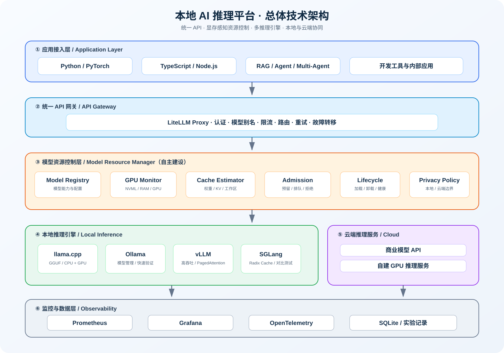

# 本地 AI 推理引擎：技术架构与落地方案 V1.0

> **文档类型：** 技术架构设计 / 落地路线  
> **项目方向：** AI 模型、推理引擎与 AI 应用开发基础设施  
> **版本：** V1.0  
> **编制日期：** 2026-11-26  
> **当前状态：** 方案设计，尚未部署或通过性能验收  
> **目标环境：** Windows 11 工作站，优先考虑 NVIDIA 单 GPU 16GB 显存基线，并预留 WSL2 / Linux 扩展能力

---

## 0. 阅读说明与结论摘要

本文规划一套可长期复用的 **Local AI Inference Platform（本地 AI 推理平台）**。平台不重新实现 Transformer 推理内核，也不自行编写底层 KV Cache 管理器，而是在成熟推理引擎之上，增加统一 API、模型注册、资源感知、请求准入、路由、监控和安全治理能力。

### 核心设计原则

- 🔵 **推理计算交给成熟引擎：** llama.cpp、Ollama、vLLM、SGLang 按场景选用。
- 🔵 **统一调用入口：** 业务应用通过统一 API 调用本地或云端模型。
- 🟢 **自主建设差异化能力：** 重点建设资源感知、请求准入、模型能力目录、隐私策略和观测体系。
- 🟠 **先测量，再优化：** 不凭模型参数量或显卡型号推断实际并发；通过固定数据集和压测得到结果。
- 🔴 **隐私策略不可绕过：** 标记为 local-only 的请求，资源不足时只能排队、拒绝或要求用户授权，不得自动发往云端。

### V1.0 推荐组合

| 能力 | 首选方案 | 定位 |
|---|---|---|
| 本地 GGUF 推理 | llama.cpp | Windows 本地推理、量化模型、CPU/GPU 混合卸载 |
| 快速模型管理 | Ollama | 下载、切换和快速验证模型 |
| 高吞吐服务 | vLLM | 后续 Linux / WSL2 高并发实验 |
| 其他高性能引擎 | SGLang | 对特定模型、前缀缓存和复杂服务场景进行对比 |
| 统一 API 网关 | LiteLLM | API 统一、认证、路由、重试、回退和用量记录 |
| 资源管理服务 | Python + FastAPI | GPU 监测、模型登记、容量估算、请求准入 |
| GPU 状态 | NVIDIA NVML | 显存、利用率、温度、功耗等 |
| 初期元数据 | SQLite | 模型目录、配置、实验记录 |
| 后续监控 | Prometheus + Grafana | 指标采集和可视化 |
| 链路观测 | OpenTelemetry | 请求链路和服务间关联 |

> 🟢 **最终定位：** 这是一套供 Python、TypeScript、AI Agent、RAG、多智能体和其他应用共享的推理基础设施，而不是某一个应用专属的模型运行脚本。

## 1. 项目目标与边界

### 1.1 建设目标

1. 通过统一 API 调用不同本地模型和云端模型，减少业务代码对具体引擎的依赖。
2. 识别模型架构、量化格式、上下文能力、任务能力和资源需求。
3. 监测 GPU / CPU / RAM，估算模型加载和请求执行所需资源。
4. 在请求执行前进行容量检查、资源预留、排队或拒绝，降低 OOM 风险。
5. 管理模型加载、卸载、健康状态和运行配置。
6. 在满足隐私策略的前提下，将适合云端处理的任务路由到云端。
7. 记录 TTFT、TPOT、吞吐量、排队时间、缓存使用率、失败率和成本。
8. 为多 Agent、多应用、多 GPU 和多机器部署保留扩展接口。

### 1.2 V1.0 不做什么

- 不训练基础大模型。
- 不自行实现 CUDA Attention 内核。
- 不自行实现 PagedAttention 或底层 KV Cache 分配器。
- 不承诺 16GB 显存可运行任意 27B / 32B 模型。
- 不承诺固定并发人数；并发能力必须通过模型、上下文、输出长度和硬件组合实测。
- 不把 LiteLLM 视为自动理解 GPU 显存的资源调度器。
- 不在第一阶段引入 Kubernetes、复杂微服务集群或不必要的 Redis / PostgreSQL。

### 1.3 成功标准

| 验收方向 | 成功标准 |
|---|---|
| 统一调用 | Python 与 TypeScript 能通过统一 API 完成一次本地模型调用 |
| 模型管理 | 能登记模型、引擎、量化格式、上下文和任务能力 |
| 资源可观测 | 能读取 GPU 显存、利用率和推理引擎指标 |
| 请求保护 | 超出容量时能够排队或明确拒绝，不盲目接收 |
| 路由 | local-only 请求绝不自动转发云端 |
| 可复现 | 同一压测配置可重复运行并保存结果 |
| 可维护 | 引擎可替换，业务应用不需要大规模改造 |

## 2. 基础术语与核心概念

### 2.1 模型权重（Model Weights）

模型训练完成后保存的参数。加载模型时，权重通常需要放入 GPU 显存、系统内存，或按引擎能力在二者之间分配。

粗略理论估算：

$$
M_{\text{weights}} \approx P \times \frac{q}{8}
$$

- $P$：参数数量。
- $q$：每个参数的平均位数。
- 结果单位为 Byte。

例如 7B 参数、平均 4 bit：

$$
7\times10^9 \times \frac{4}{8}=3.5\times10^9\text{ Bytes}
$$

这只是权重理论数据量。实际文件和运行占用还会受到量化元数据、分组尺度、对齐、未量化张量、词表、视觉模块、运行时缓冲区等影响。

### 2.2 Token 与上下文长度（Context Length）

Token 是模型处理文本的基本单位，不等于一个汉字或一个英文单词。上下文长度通常指一次请求中模型可处理的 Token 总窗口，具体包括哪些输入、历史消息和输出预算，取决于模型与服务实现。

**上下文越长，不代表只增加文本文件大小；它会增加 Prefill 计算，并可能增加 KV Cache 或其他状态缓存。**

### 2.3 Prefill 与 Decode

| 阶段 | 含义 | 常见性能指标 |
|---|---|---|
| Prefill | 处理输入提示词并建立注意力缓存 | Prompt tokens/s、TTFT |
| Decode | 根据已有上下文逐个生成输出 Token | Generation tokens/s、TPOT |

- **TTFT（Time To First Token）：** 从请求到达至第一个输出 Token 的时间。
- **TPOT（Time Per Output Token）：** 输出阶段平均每个 Token 的耗时。
- **Throughput：** 单位时间内处理或生成的 Token 数量，必须注明是单请求还是系统总吞吐量。

### 2.4 Attention、Q / K / V

- Q（Query）：当前查询向量。
- K（Key）：用于匹配和检索的键向量。
- V（Value）：被聚合的信息向量。
- Attention：通过 Q 与 K 的相关性计算权重，再对 V 加权聚合。

### 2.5 MHA、MQA、GQA、MLA

| 机制 | 核心方式 | KV 存储特点 |
|---|---|---|
| MHA | 每个 Query Head 对应独立 K/V Head | KV 头数量通常与 Q 头数量相同 |
| MQA | 所有 Query Head 共享一组 K/V | KV 头数量为 1 |
| GQA | 多个 Query Head 分组共享 K/V | KV 头数量介于 1 与 Q 头数之间 |
| MLA | 将注意力相关信息压缩到低维潜在表示并缓存 | 缓存结构不同于普通 K/V 头直接存储 |

🟠 **术语纠正：** MLA 是 Multi-head Latent Attention（多头潜在注意力），不是 Mixture of Long and Short Range Attention。MLA 也不是简单地把 GQA 与线性注意力层混在一起。

### 2.6 KV Cache

KV Cache 是推理过程中为后续 Token 复用而保存的注意力 Key / Value 状态。

它不是模型权重，而是随着活跃请求、上下文长度和生成过程动态变化的运行时状态。

- 模型权重：模型加载后通常长期驻留，直到卸载。
- KV Cache：按请求和 Token 动态分配、复用、回收或换出。
- Prefix Cache：对共享前缀已计算的缓存进行复用。
- PagedAttention：以块为单位管理 KV Cache，减少连续内存分配要求和碎片问题。

## 3. KV Cache 显存计算

### 3.1 标准 Attention 的基础公式

对标准全注意力层，单条序列、每个 Token 的 KV Cache 理论占用：

$$
M_{\text{KV/token}}=2\times L\times H_{KV}\times D\times B
$$

其中：

| 符号 | 含义 |
|---|---|
| 2 | K 和 V 两份缓存 |
| $L$ | 具有该 KV 缓存结构的 Attention 层数 |
| $H_{KV}$ | KV Head 数量 |
| $D$ | 每个 Head 的维度 |
| $B$ | 每个缓存元素占用的 Byte 数 |

FP16 / BF16 通常按每元素 2 Byte 估算；FP8 / INT8 通常按 1 Byte 估算，但具体实现还可能包含缩放因子、对齐和额外元数据。

对多条活跃序列：

$$
M_{\text{KV,total}}\approx
2\times L\times H_{KV}\times D\times B
\times \sum_{i=1}^{N}T_i
$$

其中 $T_i$ 为第 $i$ 条序列当前实际缓存的 Token 数量。若引擎预分配缓存池，物理显存占用可能按缓存池容量而非已使用 Token 数量呈现。

### 3.2 MHA / GQA / MQA 数值示例

假设：

- Attention 层数：32。
- Query Head 数：64。
- Head Dimension：128。
- 缓存精度：FP16（2 Byte）。
- 仅比较 KV Head 数量，不考虑模型质量和内核实现差异。

| 架构 | KV Head 数 | 每 Token 理论 KV | 32K Token 单序列 |
|---|---:|---:|---:|
| MHA | 64 | 1 MiB | 32 GiB |
| GQA | 8 | 128 KiB | 4 GiB |
| MQA | 1 | 16 KiB | 0.5 GiB |

计算示例（GQA）：

$$
2\times32\times8\times128\times2
=131072\text{ Bytes}=128\text{ KiB}
$$

🟠 **注意：** 这组数据是用于解释公式的假设模型，不代表某个具体开源模型的真实结构。实际模型必须读取 config、模型卡或引擎报告中的层数、KV 头数、Head Dimension、缓存精度和滑动窗口等信息。

### 3.3 MLA 与混合注意力模型如何估算

不能将普通 MHA / GQA 公式直接套用到所有 MLA、Mamba、DeltaNet 或混合注意力模型。

- MLA：需要按其潜在 KV 表示维度、位置编码相关缓存、层数和缓存精度计算。
- Mamba / DeltaNet 等状态空间或线性注意力结构：通常需要计算每层状态大小、状态精度、并发序列数及实现中的额外状态。
- 混合模型：逐层或逐缓存组估算，再汇总不同缓存类型。

因此资源管理器必须支持 **模型架构专用的 CacheEstimator**，不能只用参数量和上下文长度推算全部模型。

### 3.4 总显存预算

$$
M_{\text{required}} =
M_{\text{weights}}+
M_{\text{cache}}+
M_{\text{workspace}}+
M_{\text{runtime}}+
M_{\text{margin}}
$$

其中：

- Weights：模型权重。
- Cache：KV Cache 或其他架构状态缓存。
- Workspace：Prefill、Decode、Attention、矩阵计算等工作区。
- Runtime：CUDA 上下文、引擎缓冲区、通信和其他运行开销。
- Margin：安全余量。

🔴 **禁止只使用“模型参数量 × 量化位数”判断能否运行。** 必须同时考虑缓存、工作区、运行时和系统显存占用。

## 4. 技术架构总览

### 4.1 分层架构图

~~~mermaid
flowchart TB
    subgraph APP["① 应用接入层"]
        A1["Python / PyTorch"]
        A2["TypeScript / Node.js"]
        A3["RAG / Agent / Multi-Agent"]
        A4["开发工具与内部应用"]
    end

    subgraph GATEWAY["② 统一 API 网关"]
        G1["LiteLLM Proxy"]
        G2["认证 / 限流 / 路由 / 重试"]
    end

    subgraph CONTROL["③ 资源控制层（自主建设）"]
        C1["Model Registry"]
        C2["GPU / RAM Monitor"]
        C3["Cache & Memory Estimator"]
        C4["Admission Controller"]
        C5["Model Lifecycle Manager"]
        C6["Privacy & Routing Policy"]
    end

    subgraph LOCAL["④ 本地推理引擎"]
        L1["llama.cpp"]
        L2["Ollama"]
        L3["vLLM"]
        L4["SGLang"]
    end

    subgraph CLOUD["⑤ 云端推理服务"]
        CL1["商业模型 API"]
        CL2["自建 GPU 推理服务"]
    end

    subgraph OBS["⑥ 观测与数据层"]
        O1["Prometheus"]
        O2["Grafana"]
        O3["OpenTelemetry"]
        O4["SQLite / 后续数据库"]
    end

    APP --> G1 --> G2
    G2 --> CONTROL
    CONTROL --> LOCAL
    CONTROL --> CLOUD
    LOCAL --> OBS
    CLOUD --> OBS
    CONTROL --> OBS

    classDef blue fill:#E8F1FF,stroke:#2563EB,color:#163A70,stroke-width:1.5px;
    classDef green fill:#E8F7EF,stroke:#16A34A,color:#14532D,stroke-width:1.5px;
    classDef orange fill:#FFF3E0,stroke:#EA580C,color:#7C2D12,stroke-width:1.5px;
    classDef purple fill:#F3E8FF,stroke:#9333EA,color:#581C87,stroke-width:1.5px;
    class A1,A2,A3,A4,G1,G2 blue;
    class C1,C2,C3,C4,C5,C6 orange;
    class L1,L2,L3,L4 green;
    class CL1,CL2 purple;
    class O1,O2,O3,O4 blue;
~~~

### 4.2 各层职责

| 层级 | 主要职责 | 不应承担的职责 |
|---|---|---|
| 应用接入层 | 业务逻辑、Agent、RAG、工具调用 | 不直接管理 GPU |
| API 网关 | 统一协议、认证、路由、限流、回退 | 不假定自己掌握 GPU 实时容量 |
| 资源控制层 | 模型登记、资源预算、请求准入、隐私策略 | 不执行底层矩阵计算 |
| 推理引擎层 | 权重加载、Token 推理、缓存分配和调度 | 不负责所有业务身份与成本规则 |
| 云端服务层 | 承接获准发送到云端的任务 | 不得接收 local-only 数据 |
| 观测层 | 指标、日志、链路、实验结果 | 不应记录不必要的原始敏感提示词 |

### 4.3 关键架构边界

🟠 LiteLLM 具备模型路由、负载均衡、重试、故障转移等能力，但不能直接等同于“GPU 显存感知调度器”。

V1.0 采用两种职责：

1. LiteLLM 负责 API 层路由与服务治理。
2. 自建 Resource Manager 负责读取引擎和 GPU 状态，制定容量策略，并通过适配器、路由配置或受控服务入口执行决策。

在真正接入之前，必须验证所选 LiteLLM 版本的回调、路由和自定义集成方式；不要假设任何内部钩子都能同步执行 GPU 资源预留。

## 5. 推理引擎选型

### 5.1 引擎对比

| 引擎 | 主要优势 | 适用场景 | V1.0 定位 |
|---|---|---|---|
| Ollama | 模型获取和管理简单，开发体验好 | 快速验证、个人使用、轻量服务 | P0 工具 |
| llama.cpp | GGUF、量化、CPU/GPU 混合卸载、轻量 Server | 消费级显卡、本地实验、灵活部署 | P0 主力 |
| vLLM | PagedAttention、连续批处理、前缀缓存和指标体系 | Linux GPU 高吞吐服务 | P1 |
| SGLang | RadixAttention、前缀复用和高性能服务能力 | 复杂提示词复用、特定模型服务 | P2 对比 |

#### Ollama

适合快速下载、运行和切换模型。官方 FAQ 说明并发能力受可用内存、模型加载状态和并行请求配置影响；同一模型并行请求会提高上下文内存需求。[3]

#### llama.cpp

适合 GGUF 模型、CPU/GPU 混合卸载和本地服务。官方 Server 文档列出 OpenAI 兼容接口、并行解码、多用户支持、连续批处理和监控端点等能力。[1]

#### vLLM

适合后续 Linux / WSL2 环境下的高吞吐推理。官方文档提供 KV Cache、Prefix Cache、请求运行状态和延迟等 Prometheus 指标。[4][5]

#### SGLang

作为后续候选引擎，通过实际模型、硬件和工作负载与 vLLM 对比后再决定是否保留，不在 P0 阶段同时部署。

### 5.2 推荐部署顺序

1. 先部署 llama.cpp，建立本地模型推理基线。
2. 安装 Ollama，便于快速下载和验证其他模型。
3. 两者先不要同时加载多个大模型，避免争抢同一 GPU 显存。
4. 资源监控和压测体系建立后，再部署 vLLM。
5. 最后选择一到两个代表性任务评估 SGLang，不因框架数量多而增加维护负担。

## 6. 统一 API 网关

### 6.1 为什么需要 API Gateway

如果业务代码直接调用 Ollama、llama.cpp、vLLM 各自接口，未来更换推理引擎时，每个项目都需要修改。

统一 API 后，业务应用只需要知道：

- API 地址。
- API Key。
- 模型别名。
- 请求格式。
- 返回格式。

网关负责将请求转发给具体部署。

### 6.2 LiteLLM 的职责

- OpenAI 风格接口统一。
- 模型别名和部署映射。
- API Key、用户和团队权限。
- RPM / TPM 限制。
- 重试和故障转移。
- 请求和用量记录。
- Prometheus 指标及可观测性集成。

### 6.3 建议接口

统一入口示例（端口仅为规划值，部署时确认没有冲突）：

~~~text
http://127.0.0.1:4000/v1/chat/completions
http://127.0.0.1:4000/v1/embeddings
~~~

模型别名示例：

| 对外模型名 | 实际部署 | 任务类型 |
|---|---|---|
| local-chat-fast | 本地轻量模型 | 普通问答 |
| local-code | 本地代码模型 | 代码生成 |
| local-reasoning | 本地推理模型 | 复杂分析 |
| local-embedding | Embedding 模型 | 向量化 |

| local-reranker | Reranker 模型 | 相关性排序 |
| cloud-reasoning | 云端推理模型 | 获准的复杂任务 |

以上名称是逻辑别名，不代表具体模型已经安装。

## 7. 自主建设模块：Model Resource Manager

### 7.1 模块定位

这是平台最重要的自研模块。它不重新实现推理引擎，而是建立统一资源视图和请求准入控制。

推荐技术：

| 组件 | 选择 | 原因 |
|---|---|---|
| API 服务 | Python + FastAPI | Python AI 生态和异步接口 |
| 数据验证 | Pydantic | 模型配置与请求结构校验 |
| GPU 监测 | NVIDIA NVML / pynvml | 读取 NVIDIA GPU 状态 |
| 初期数据 | SQLite | 单机部署简单 |
| 并发控制 | asyncio + 进程内锁 / 数据库事务 | 初期单机协调 |
| 多进程协调 | 后续评估 Redis | 仅在实际需要时引入 |

### 7.2 功能模块

1. **Model Registry：** 模型名称、版本、架构、参数规模、格式、量化、引擎、上下文和能力。
2. **GPU Monitor：** 显存总量、使用量、空闲量、利用率、温度和功耗。
3. **Cache Estimator：** 根据模型架构估算 KV Cache 或其他状态缓存。
4. **Admission Controller：** 请求准入、资源预留、排队、拒绝。
5. **Model Lifecycle Manager：** 加载、卸载、健康检查和空闲回收策略。
6. **Privacy Policy：** local-only、cloud-allowed 等数据处理边界。
7. **Engine Adapter：** 读取不同引擎的健康状态、模型状态和指标。

### 7.3 模型注册信息

建议模型注册记录包含：

~~~yaml
model_id: local-code-model
display_name: Local Coding Model
provider: llama_cpp
model_family: example-family
parameter_size: 7B
format: GGUF
quantization: Q4_K_M
architecture: transformer_gqa
context_length: 16384
task_capabilities:
  - code
  - chat
cache_estimator: transformer_gqa_v1
engine:
  type: llama_cpp
  endpoint: http://127.0.0.1:8080
  model_alias: local-code
privacy_level: local_only
status: unloaded
~~~

注意：这是配置结构示例，模型参数、上下文长度和能力必须根据实际模型文件、官方模型卡及引擎加载结果填写，不能照抄示例值。

### 7.4 请求准入流程

~~~mermaid
flowchart TD
    A["收到模型请求"] --> B["解析模型与任务需求"]
    B --> C["检查隐私策略"]
    C --> D{"是否允许云端处理？"}
    D -->|否| E["仅允许本地候选模型"]
    D -->|是| F["本地与云端均可进入候选集"]
    E --> G["检查模型能力与上下文"]
    F --> G
    G --> H["读取 GPU / 引擎缓存池状态"]
    H --> I["估算本次资源增量"]
    I --> J{"是否有可用容量？"}
    J -->|有| K["原子预留资源并提交引擎"]
    J -->|无| L{"是否允许排队？"}
    L -->|是| M["进入有上限的队列"]
    L -->|否| N["拒绝并返回明确原因"]
    K --> O["执行推理"]
    M --> H
    O --> P["释放请求级资源并记录指标"]
    N --> Q["返回可处理的错误信息"]

    classDef good fill:#E8F7EF,stroke:#16A34A,color:#14532D;
    classDef warn fill:#FFF3E0,stroke:#EA580C,color:#7C2D12;
    classDef bad fill:#FEE2E2,stroke:#DC2626,color:#7F1D1D;
    class K,O,P good;
    class L,M warn;
    class N,Q bad;
~~~

### 7.5 资源预留必须原子化

不能采用“读取显存 → 判断够用 → 再提交请求”的无保护流程。多个请求可能同时读到相同空闲容量，并全部通过检查。

必须至少实现：

1. 单机内对模型资源预算进行原子预留。
2. 请求进入执行、排队、取消、超时和完成时维护预留状态。
3. 请求实际 Token 数与最大输出预算要区分。
4. 处理引擎缓存池预分配、分页块分配和内部工作区。
5. 资源状态不确定时采用保守策略。
6. 定期对账资源管理器的预留值与引擎实际指标。

V1.0 建议先做单 GPU、单推理引擎、单模型实例的闭环，之后再扩展多模型和多 GPU。

## 8. 缓存优化体系

### 8.1 四类关键优化

| 技术 | 解决的问题 | 主要收益 | 注意事项 |
|---|---|---|---|
| KV Cache Quantization | 每个缓存元素占用过多 | 降低缓存显存 | 可能影响质量，需内核支持 |
| PagedAttention | 缓存块分配和碎片 | 提升缓存管理效率 | 不等于每 Token 数据量自动减少 |
| Prefix Caching | 相同前缀重复 Prefill | 降低重复 Prefill 计算 | 必须满足 Token 前缀匹配条件 |
| KV Offloading | GPU 缓存空间不足 | 扩大可容纳状态规模 | CPU / PCIe 传输可能降低性能 |

### 8.2 Prefix Caching 的边界

vLLM Automatic Prefix Caching 可以复用具有相同前缀的 KV Cache，减少共享前缀的重复计算。[5]

但要注意：

- 共享前缀必须保持 Token 级一致。
- 前缀中途变化，后续缓存块可能不能继续命中。
- 主要优化 Prefill，不直接加速长输出阶段的 Decode。
- 共享系统提示词不代表可以共享不同用户的完整对话内容。
- 缓存命中、缓存驻留和显存释放是不同指标。

### 8.3 缓存精度建议

| 级别 | 精度 | 使用策略 |
|---|---|---|
| 基准 | FP16 / BF16 | 首先建立质量与性能基线 |
| 优化 A | FP8 | 引擎、GPU 和模型支持时测试 |
| 优化 B | INT8 | 作为具体引擎能力进行验证 |
| 实验 | INT4 | 仅在支持且有质量评测时启用 |

🔴 不允许只因 INT4 占用更低就默认使用。每种精度都要记录显存、TTFT、TPOT、吞吐量和任务质量。

## 9. 任务路由与本地 / 云端混合推理

### 9.1 任务分类

| 任务 | 模型能力要求 | 默认策略 |
|---|---|---|
| 文本分类、简单抽取 | 轻量文本模型 | 本地优先 |
| 普通问答 | 通用指令模型 | 本地优先 |
| 代码生成 | Coding 能力 | 本地专用模型优先 |
| 复杂推理 | 强推理能力 | 按质量、成本和隐私选择 |
| 图片理解 | 视觉编码器 / 多模态能力 | 视觉模型 |
| Embedding | 向量模型 | 专用 Embedding |
| Reranking | 排序模型 | 专用 Reranker |
| 超长文档 | 长上下文能力与足够缓存 | 按实际上下文和资源选择 |

### 9.2 路由流程

~~~mermaid
flowchart TD
    A["应用提交请求"] --> B["任务识别与能力约束"]
    B --> C["读取数据隐私级别"]
    C --> D{"local_only？"}
    D -->|是| E["过滤所有云端候选"]
    D -->|否| F["允许云端候选（需符合授权）"]
    E --> G["评估本地模型质量与资源"]
    F --> G
    G --> H{"本地候选可用？"}
    H -->|是| I["选择本地模型"]
    H -->|否| J{"是否允许云端？"}
    J -->|是| K["选择合规云端模型"]
    J -->|否| L["排队 / 拒绝 / 请求用户决策"]
    I --> M["推理与结果记录"]
    K --> M
    L --> N["明确告知资源不足或需授权"]
~~~

### 9.3 路由决策优先级

1. 隐私与数据边界。
2. 任务能力匹配。
3. 模型质量要求。
4. 当前资源容量与预计排队时间。
5. 响应延迟要求。
6. 云端费用与本地资源成本。
7. 模型可用性和历史可靠性。

**禁止静默降级：** 请求指定模型不可用时，如果实际使用了其他模型，必须在调用记录中保存 requested_model、actual_model 和 fallback_reason。

## 10. Windows 11 + WSL2 部署规划

### 10.1 环境职责

| 环境 | 运行内容 | 主要用途 |
|---|---|---|
| Windows 11 | Python、PyTorch、Transformers、开发工具 | 模型开发、实验和业务开发 |
| Windows 11 | Ollama、llama.cpp（CUDA 构建） | 本地快速推理 |
| WSL2 Ubuntu | vLLM、SGLang（按兼容性验证） | Linux 推理服务实验 |
| Docker（可选） | 网关和监控组件 | 环境隔离和部署复现 |

Windows + WSL2 的选择是本项目的初始工程路线，不代表所有组件都必须容器化，也不代表 Windows 与 WSL2 的 GPU 资源彼此隔离。两边使用同一块物理 GPU 时，显存仍然是共享资源。

### 10.2 目录规划

建议模型文件和项目源码分开：

~~~text
D:\AI\
├── models\
│   ├── gguf\
│   ├── safetensors\
│   ├── embeddings\
│   ├── rerankers\
│   └── vision\
├── cache\
│   ├── huggingface\
│   ├── ollama\
│   └── inference\
├── workspace\
│   ├── local-ai-platform\
│   ├── pytorch-lab\
│   ├── transformers-lab\
│   └── agent-lab\
├── logs\
├── benchmarks\
└── configs\
~~~

实际目录可根据磁盘分区调整。Windows 路径和 WSL2 路径需要通过明确的挂载配置映射，不可直接假定两边路径完全一致。

### 10.3 端口规划（建议值）

| 服务 | 规划端口 | 备注 |
|---|---:|---|
| LiteLLM | 4000 | 统一 API |
| Resource Manager | 8001 | 内部管理 API |
| Ollama | 11434 | 默认常见端口，确认实际配置 |
| llama.cpp | 8080 | 示例端口 |
| Prometheus | 9090 | 指标采集 |
| Grafana | 3000 | 可视化 |

默认只绑定本机回环地址。确实需要局域网访问时，再增加身份认证、防火墙规则和访问控制。

## 11. 监控、评测与压测

### 11.1 必须采集的指标

| 指标 | 含义 | 用途 |
|---|---|---|
| GPU VRAM Used / Free | 显存使用与剩余 | 资源容量 |
| GPU Utilization | GPU 利用率 | 计算负载 |
| Temperature / Power | 温度和功耗 | 稳定性 |
| KV Cache Usage | 引擎缓存池使用率 | 请求准入 |
| Active / Waiting Requests | 执行和等待请求 | 并发 |
| TTFT | 首 Token 延迟 | 用户等待体验 |
| TPOT | 输出 Token 间隔 / 平均耗时 | 生成速度 |
| Prompt Tokens/s | 输入处理速度 | Prefill 性能 |
| Generation Tokens/s | 输出速度 | Decode 性能 |
| Queue Time | 排队耗时 | 调度质量 |
| OOM Count | 显存溢出次数 | 稳定性 |
| Prefix Cache Hit | 前缀缓存命中 | 缓存效果 |
| Error Rate | 请求失败率 | 可靠性 |
| Cloud Fallback Rate | 云端回退比例 | 成本与本地能力 |

vLLM 官方指标包括运行请求数、KV Cache 使用率、Prefix Cache 命中、输入 / 输出 Token、TTFT 和 TPOT 等。[4]

### 11.2 压测维度

每次测试必须固定并记录：

- 模型名称、模型文件哈希和量化格式。
- 推理引擎版本、启动参数和 CUDA 版本。
- GPU 型号、显存容量、驱动版本。
- 上下文长度与输入 Token 数。
- 最大输出 Token 数。
- 并发请求数。
- 是否开启 Prefix Cache。
- KV Cache 精度。
- 是否有其他 GPU 任务运行。

测试矩阵建议：

| 测试 | 并发 | 输入长度 | 输出长度 | 目的 |
|---|---:|---:|---:|---|
| 基准 | 1 | 2K | 256 | 单请求基线 |
| 并发 A | 2 | 2K | 256 | 初始并发 |
| 并发 B | 4 | 2K | 256 | 并发增长 |
| 长上下文 A | 1 | 8K | 256 | 长输入影响 |
| 长上下文 B | 1 | 16K | 256 | 缓存压力 |
| 混合负载 | 2–4 | 2K–8K | 128–512 | 真实工作负载 |
| 前缀复用 | 2–4 | 相同系统前缀 | 256 | 缓存命中收益 |

上述并发数和 Token 数是测试档位，不是硬件性能承诺。

### 11.3 验收指标

- 能稳定完成测试矩阵，无非预期 OOM。
- 每次测试有完整配置和原始指标。
- 记录 P50、P95 延迟，而不是只记录平均值。
- 分别报告 Prefill 与 Decode 性能。
- 对比缓存开启 / 关闭时的质量、延迟和显存。
- 记录排队、拒绝、取消和超时行为。
- 质量评测必须使用固定任务集，不能只凭主观感受判断。

## 12. 安全与隐私边界

### 12.1 数据等级

| 等级 | 定义 | 允许处理位置 |
|---|---|---|
| local-only | 不允许离开本地设备或指定私有网络 | 本地模型 |
| private-network | 仅允许经过批准的私有服务 | 指定私有推理服务 |
| cloud-allowed | 经授权可发送云端 | 合规云端 API 或本地 |
| public | 公开数据 | 本地或云端 |

### 12.2 必须落实的控制

1. 默认只监听 127.0.0.1。
2. API Key 不写入仓库、不提交 Git。
3. 云端调用必须通过隐私策略检查。
4. 日志默认不记录完整敏感提示词和附件内容。
5. 记录请求 ID、模型、Token 数、延迟和路由结果。
6. 对模型文件来源、许可证和使用限制进行登记。
7. 模型下载文件记录版本、来源和哈希。
8. 资源管理 API 不向普通业务用户开放危险的模型卸载和系统操作接口。

## 13. 实施路线与阶段验收

### PHASE 01 — Local AI Foundation（基础环境）

**目标：** 建立可用的本地推理基础。

工作内容：

- 检查 Windows、NVIDIA 驱动、GPU 和 CUDA 环境。
- 建立 Python / PyTorch 基础环境并验证 GPU 可用。
- 安装 Ollama 并完成一个模型的加载与调用。
- 部署 llama.cpp CUDA Server，完成 GGUF 推理。
- 建立 LiteLLM 统一 API。
- Python 与 TypeScript 分别完成调用测试。
- 建立模型和缓存目录规范。
- 保存环境版本与验证结果。

**验收：** 两种语言都能通过统一入口调用本地模型；能够证明请求实际由 GPU 或预期的 CPU/GPU 路径执行。

### PHASE 02 — Intelligent Resource Manager（资源管理）

**目标：** 建立可观测、可预测、可保护的单机资源管理能力。

工作内容：

- GPU / RAM 监控。
- 模型注册中心。
- 引擎适配器。
- CacheEstimator。
- 请求容量估算。
- 原子资源预留。
- 请求队列和上限。
- 模型生命周期管理。
- local-only 策略。
- 资源对账与异常恢复。

**验收：** 超过预算的请求不会被无控制地提交；队列、拒绝、取消和完成都能正确记录；资源状态可以对账。

### PHASE 03 — High Performance Inference（高性能推理）

**目标：** 建立 Linux 高吞吐推理对比环境。

工作内容：

- 配置 WSL2 / Ubuntu 与 GPU 访问。
- 部署 vLLM。
- 测试 PagedAttention 与 Prefix Caching。
- 测试支持的 KV Cache 精度。
- 进行 Continuous Batching 压测。
- 选择代表模型对比 SGLang。
- 输出性能和资源对比报告。

**验收：** 形成可重复的吞吐、延迟、显存、质量和稳定性报告；不以单次最佳结果作为结论。

### PHASE 04 — Multi-Agent & Cloud Hybrid（混合推理）

**目标：** 供多个 AI 应用和 Agent 统一使用。

工作内容：

- 任务类型和模型能力目录。
- 多模型路由。
- 本地与云端混合调度。
- 数据隐私策略。
- 故障转移与降级记录。
- Token 和成本统计。
- Prometheus / Grafana。
- OpenTelemetry。
- 多 GPU 扩展设计。

**验收：** 多个应用通过同一 API 使用不同模型；路由行为可追踪；隐私策略不可绕过；失败和回退可审计。

## 14. 风险与待验证事项

| 风险 | 影响 | 处理策略 |

|---|---|---|
| 16GB 显存不足以容纳目标模型与缓存 | 加载失败或 OOM | 量化、缩短上下文、卸载部分层、排队或更换模型 |
| 不同模型缓存结构不同 | 容量估算错误 | 按架构实现 CacheEstimator |
| 多个引擎争用同一 GPU | 性能下降或 OOM | 初期同一时间只让一个主要大模型引擎占用 GPU |
| 引擎预分配缓存池 | NVML 空闲值与逻辑容量不一致 | 同时采集引擎指标和 NVML |
| LiteLLM 路由与资源管理耦合 | 请求准入不可靠 | 通过明确的适配接口和集成测试实现 |
| WSL2 与 Windows 路径映射 | 模型文件不可访问或重复存储 | 明确统一存储和挂载策略 |
| KV Cache 量化影响输出质量 | 任务准确性下降 | 固定任务集做质量对照 |
| 云端回退泄露隐私 | 数据安全风险 | local-only 请求彻底排除云端候选 |
| 模型许可证不允许特定用途 | 合规风险 | 下载前登记许可证与用途限制 |

## 15. V1.0 最终技术决策

| 决策项 | 当前决定 | 决策状态 |
|---|---|---|
| 总体架构 | API 网关 + 自研资源控制层 + 多推理引擎 | 已确定设计方向 |
| 初始操作系统 | Windows 11 | 以当前工作环境为基线 |
| Linux 推理 | WSL2 / Ubuntu | 待环境验证 |
| 本地主要引擎 | llama.cpp | 推荐优先验证 |
| 快速模型管理 | Ollama | 推荐采用 |
| 高吞吐引擎 | vLLM | P1 |
| 引擎对比 | SGLang | P2 |
| 统一 API | LiteLLM | 推荐采用 |
| 资源管理 | FastAPI + NVML | 自研模块 |
| 初期数据 | SQLite | 推荐采用 |
| 监控 | Prometheus + Grafana | P1 |
| 初始 GPU 基线 | 16GB 显存单卡 | 暂定，最终以实际硬件为准 |
| 并发能力 | 实测决定 | 不预设固定人数 |
| 云端回退 | 仅对 cloud-allowed 请求开放 | 安全约束 |

### 15.1 进入 PHASE 01 前需要采集的实际环境

- GPU 型号、显存容量、驱动版本。
- CPU 型号与核心数。
- 系统内存容量和频率。
- NVMe 磁盘容量及模型存储位置。
- Windows 版本。
- Python 版本。
- 当前 CUDA / PyTorch 状态。
- 是否已经启用 WSL2。

在获得这些信息之前，不锁定 CUDA、PyTorch、vLLM、SGLang 的具体版本组合，也不提供未经验证的一键安装命令。

---

## 附录 A：核心术语速查表

| 术语 | 中文解释 | 一句话理解 |
|---|---|---|
| LLM | 大语言模型 | 通过大量参数学习语言与任务模式的模型 |
| Inference | 推理 | 使用训练完成的模型生成结果 |
| Transformer | Transformer 架构 | 现代大语言模型常用的基础网络架构 |
| Attention | 注意力机制 | 计算 Token 之间的信息关联 |
| MHA | 多头注意力 | 每个查询头有自己的 K/V 头 |
| MQA | 多查询注意力 | 所有查询头共享一组 K/V |
| GQA | 分组查询注意力 | 一组查询头共享一组 K/V |
| MLA | 多头潜在注意力 | 将注意力缓存压缩为低维潜在表示 |
| KV Cache | 键值缓存 | 保存历史注意力状态，避免重复计算 |
| Prefill | 输入预处理阶段 | 处理提示词并建立缓存 |
| Decode | 自回归生成阶段 | 逐个生成后续 Token |
| Quantization | 量化 | 降低权重或缓存的数值精度 |
| GGUF | 模型文件格式 | llama.cpp 生态常用的模型文件格式 |
| Safetensors | 张量文件格式 | 用于安全存储模型张量 |
| PagedAttention | 分页注意力缓存管理 | 按块管理 KV Cache |
| Prefix Caching | 前缀缓存 | 复用相同前缀已计算的状态 |
| Continuous Batching | 连续批处理 | 请求动态加入和退出批次 |
| Embedding | 向量嵌入 | 将文本或其他内容映射为向量 |
| Reranker | 重排序模型 | 对候选文档按相关性重新排序 |
| RAG | 检索增强生成 | 检索外部资料后再让模型回答 |
| Agent | 智能体 | 能够规划、调用工具并执行任务的系统 |
| Gateway | 网关 | 统一接收和转发请求 |
| NVML | NVIDIA 管理库 | 获取 NVIDIA GPU 运行状态 |
| TTFT | 首 Token 延迟 | 请求发出后等到第一个 Token 的时间 |
| TPOT | 每输出 Token 耗时 | 衡量连续生成速度 |
| OOM | 内存不足 | 申请资源失败，常见于显存不足 |

## 附录 B：参考资料与官方文档

以下链接作为技术依据和后续实施入口。框架版本、参数和硬件支持会变化，真正安装时应以对应版本的官方文档为准。

1. llama.cpp Server：<https://github.com/ggml-org/llama.cpp/blob/master/tools/server/README.md>
2. llama.cpp CUDA 构建：<https://github.com/ggml-org/llama.cpp/blob/master/docs/build.md>
3. Ollama FAQ（并发、队列和内存）：<https://github.com/ollama/ollama/blob/main/docs/faq.md>
4. vLLM Metrics：<https://docs.vllm.ai/en/latest/design/metrics/>
5. vLLM Automatic Prefix Caching：<https://docs.vllm.ai/en/latest/features/automatic_prefix_caching/>
6. vLLM Cache Configuration：<https://docs.vllm.ai/en/latest/api/vllm/config/cache/>
7. LiteLLM Routing：<https://docs.litellm.ai/docs/routing>
8. LiteLLM Architecture：<https://docs.litellm.ai/docs/proxy/architecture>
9. LiteLLM Prometheus：<https://docs.litellm.ai/docs/proxy/prometheus>
10. SGLang：<https://docs.sglang.ai/>
11. NVIDIA NVML：<https://developer.nvidia.com/management-library-nvml>
12. PyTorch：<https://pytorch.org/docs/stable/index.html>
13. Hugging Face Transformers：<https://huggingface.co/docs/transformers/index>

## 附录 C：版本记录

| 版本 | 日期 | 变更 |
|---|---|---|
| V1.0 | 2026-11-26 | 建立本地 AI 推理平台总体架构、技术选型、KV Cache 计算、资源管理、混合路由和实施路线；统一行内与行间公式定界符，兼容 Obsidian 与 VS Code 内置 Markdown 预览 |

---

> **重要声明：** 本文是架构设计文件，不代表软件已经安装、模型已经下载、性能已经验证或并发指标已经达成。所有性能结论必须通过指定硬件、指定模型、指定引擎和可复现压测获得。
