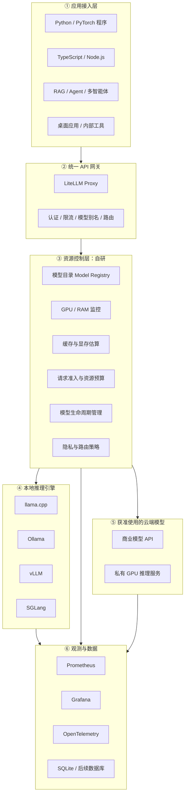
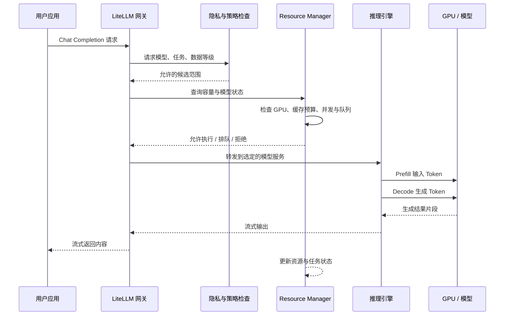

# 01 — 本地 AI 推理平台：总体架构与请求生命周期

> 对应原方案：第 0、1、4、6、7、9 章  
> 学习目标：看懂平台由哪些模块组成、每个模块负责什么，以及一条请求如何从应用到达 GPU 并返回结果。

## 1. 先理解“本地 AI 推理平台”是什么

本地 AI 推理平台（Local AI Inference Platform）不是一个单独的大模型，也不是一个聊天窗口。它是一组软件组件组成的基础设施，让不同应用能够统一使用本机或私有网络中的模型，并对模型、GPU 资源、请求、安全和运行状态进行管理。

可以把它类比成一个小型的“模型服务中心”：

- 模型：提供语言理解、代码生成、图像理解等能力。
- 推理引擎：把模型加载起来，执行实际计算。
- API 网关：接收应用请求，并将请求转给对应服务。
- 资源管理器：检查资源和策略，决定请求是否可以执行。
- 监控系统：记录性能、资源和错误。
- 云端服务：只在数据策略允许时，作为额外的推理资源。

## 2. 模型、推理引擎、平台的区别

| 名词 | 英文 | 作用 | 类比 |
|---|---|---|---|
| 模型 | Model | 定义模型结构和训练得到的参数 | 大脑的知识与能力 |
| 推理引擎 | Inference Engine / Runtime | 加载模型并执行推理计算 | 让大脑运行的执行环境 |
| 模型服务 | Model Server | 将推理能力包装成可调用服务 | 对外提供服务的窗口 |
| 推理平台 | Inference Platform | 管理多个模型服务、路由、资源、安全和监控 | 管理整个服务中心的系统 |

一个模型文件并不等于可直接调用的服务。它需要受支持的模型架构实现、权重加载器、Tokenizer、计算内核、内存管理和服务接口等配合。

## 3. 六层架构

### 3.1 应用接入层（Application Layer）

它是使用模型的业务程序，例如：

- Python 脚本或 PyTorch 项目。
- TypeScript / Node.js 后端。
- RAG 文档问答系统。
- AI Agent 或多智能体程序。
- 桌面助手、开发工具和内部管理后台。

这一层负责业务逻辑、用户交互、上下文组织和工具调用。原则上不应让每个业务应用自己管理 GPU 显存。

### 3.2 API 网关层（API Gateway）

API Gateway 是统一请求入口。应用不必知道实际模型运行在 Ollama、llama.cpp、vLLM 还是云端，只需要按约定的 API 协议发送请求。

常见职责：

- 统一 API 格式。
- 身份认证和 API Key 校验。
- 模型别名映射。
- 请求路由。
- 限流、重试和故障回退。
- 记录调用量和请求结果。

本项目计划使用 LiteLLM。它是模型代理和路由组件，不是 GPU 推理引擎。

### 3.3 资源控制层（Resource Control Layer）

这是项目准备自主开发的差异化部分。它维护平台层面的资源视图和策略，例如：

- 哪些模型已经登记？
- 模型使用哪种引擎、文件格式和量化？
- GPU 总显存和当前显存使用量是多少？
- 当前模型是否已经加载？
- 预计新增请求需要多少缓存资源？
- 请求应该执行、排队还是拒绝？
- 该请求是否允许发送到云端？

**边界：** 资源控制层不负责执行矩阵乘法，不自行实现 Attention CUDA 内核，也不替代推理引擎内部的 KV Cache 分配器。

### 3.4 推理引擎层（Inference Engine Layer）

真正执行模型计算的组件。它负责读取模型权重、执行 Prefill 和 Decode、管理运行时缓存，并尽可能利用 CPU/GPU 硬件。

V1.0 的候选是 llama.cpp、Ollama、vLLM、SGLang。它们能力重叠但定位和内部实现不同，详见第 04 篇。

### 3.5 云端推理层（Cloud Inference）

当本地资源不足或任务需要更强模型时，平台可能把请求转发到云端。但这必须服从数据分类、用户授权和隐私策略。

- local-only：禁止发往外部云端。
- private-network：只允许指定私有服务。
- cloud-allowed：满足授权和合规条件后才允许云端处理。
- public：公开数据，可按业务策略选择本地或云端。

**资源不足不等于自动获得发送敏感数据的权限。**

### 3.6 观测层（Observability Layer）

它横向观察各个模块，记录指标、日志和请求链路。不是每条请求都必须经过 Grafana 或 Prometheus；它们是监控与分析工具。

## 4. 一条请求的完整生命周期

假设用户在桌面 AI 助手中输入：“分析这个 Python 项目的性能瓶颈。”

### 步骤解释

1. **请求提交：** 应用提交模型名称、消息、最大输出长度、流式选项等参数。
2. **身份与策略检查：** 网关验证调用者；策略层确认数据是否允许使用本地或云端模型。
3. **模型解析：** 将外部模型别名映射到实际部署。
4. **资源检查：** 检查模型是否可用、GPU 是否有容量、请求是否需要排队。
5. **请求准入：** 决定接收、等待、拒绝，或在获准范围内选择备用模型。
6. **推理执行：** 推理引擎处理输入并生成输出。
7. **流式返回：** 生成一个或多个 Token 后，逐步返回应用。
8. **结束与对账：** 记录耗时、Token 数、错误和资源变化；释放请求级资源。

## 5. 关键术语解释

| 术语 | 中文 | 在本项目中的含义 |
|---|---|---|
| Layer | 层 | 架构中的职责分层；也可能指神经网络层，需结合上下文 |
| Component | 组件 | 负责一组明确功能的软件单元 |
| Service | 服务 | 通过进程或网络接口提供能力的程序 |
| Endpoint | 接口端点 | 可访问的 API 路径，例如 /v1/chat/completions |
| Request | 请求 | 应用发起的一次模型调用 |
| Response | 响应 | 模型服务返回的结果 |
| Streaming | 流式输出 | 结果生成后逐步传回，而非全部完成后一次返回 |
| Routing | 路由 | 选择请求要去哪个模型或服务 |
| Fallback | 回退 | 主候选不可用时按规则使用备用候选 |
| Failover | 故障转移 | 某个服务故障后转到备用服务，通常强调故障场景 |
| Observability | 可观测性 | 通过指标、日志、追踪理解系统内部运行状态 |

## 6. 容易混淆：网关和资源管理器

| 问题 | API 网关 | 资源管理器 |
|---|---|---|
| 统一接收请求 | 是 | 通常不是 |
| 验证 API Key | 是 | 可提供内部权限接口，但非主要职责 |
| 模型别名映射 | 是 | 提供模型元数据 |
| 读取 GPU 显存 | 不应假定具备 | 是 |
| 估算缓存预算 | 不应假定具备 | 是 |
| 资源准入 | 需要与资源管理器集成 | 是 |
| 执行推理 | 否 | 否 |
| 管理引擎生命周期 | 通过集成触发 | 是 |

关键点：LiteLLM 能做模型路由和服务治理，但不能仅凭自身的 API 路由能力，就知道某张 GPU 还剩多少可安全使用的 KV Cache 容量。必须有资源数据来源和明确集成机制。

## 7. 架构设计中最重要的边界

- 不在业务应用中重复实现 GPU 管理。
- 不在 LiteLLM 中塞入全部硬件管理逻辑。
- 不在自研 Resource Manager 中重新实现推理内核。
- 不认为 NVML 的“空闲显存”就是引擎可用缓存。
- 不允许 local-only 请求因为本地资源不足而静默转发云端。
- 不把“架构图画出来”当成“功能已经实现”。

## 8. 对应开发阶段

| 原方案阶段 | 本篇涉及内容 |
|---|---|
| PHASE 01 | 模型服务、统一 API、应用调用 |
| PHASE 02 | Resource Manager、准入、资源状态 |
| PHASE 03 | 高性能引擎、缓存和压测 |
| PHASE 04 | 多应用路由、混合推理、观测和安全 |

## 9. 阅读检查

1. 模型文件为什么不能直接等同于模型服务？
2. 推理引擎和资源管理器的职责有什么区别？
3. LiteLLM 为什么不能直接替代 GPU 资源调度器？
4. 一次请求从应用到 GPU 再返回，经过哪些主要环节？
5. 为什么 local-only 请求不能自动回退到云端？
