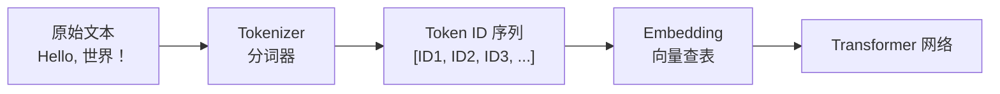
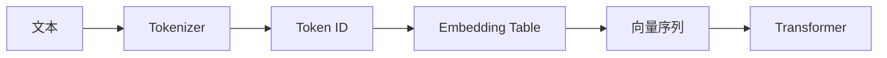
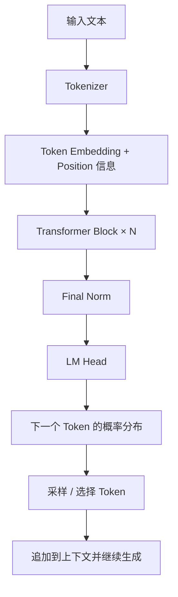
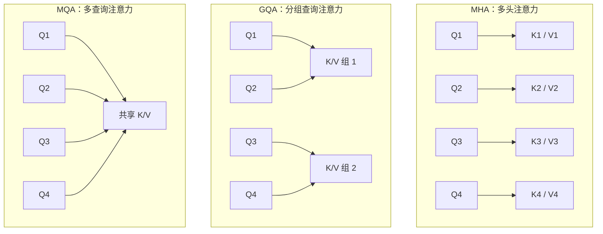
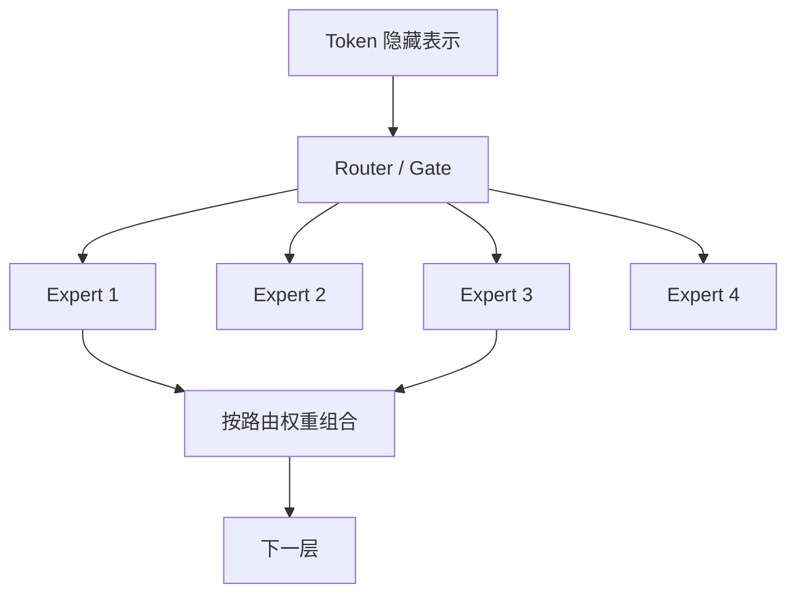

# 02 — 大模型基础与 Transformer 架构

> 对应原方案：第 2、3、9 章及附录 A  
> 学习目标：理解模型是什么、文本如何变成 Token、Transformer 如何处理 Token，以及 MHA、GQA、MQA、MLA、Dense、MoE 的关系。

## 1. LLM 是什么

LLM（Large Language Model，大语言模型）是一类通过大量数据训练、具有大量可学习参数的模型。它可以根据输入上下文预测后续 Token，并由此完成问答、摘要、翻译、代码生成等任务。

需要区分三个概念：

- **模型架构（Architecture）：** 网络由哪些模块组成、数据如何流动。
- **模型权重（Weights）：** 训练得到的参数数值。
- **模型能力（Capability）：** 在特定任务上的实际表现，需要通过评测验证。

模型名称、参数量或宣传描述本身不能证明它在你的具体任务上一定更好。

## 2. Token：模型处理文字的基本单位

Token 通常译为“词元”。它是 Tokenizer 将文本切分后交给模型处理的离散单位。

Token 不等于汉字，也不等于英文单词：

- 一个英文单词可能被切成一个或多个 Token。
- 一个汉字可能对应一个 Token，也可能和其他字符组合成不同切分。
- 标点、空格、代码符号也可能占用 Token。
- 不同模型的 Tokenizer 不同，同一段文字的 Token 数可能不同。

### 2.1 Tokenizer（分词器）

Tokenizer 负责把文本转换成 Token ID，也负责把模型输出的 Token ID 转回文本。

常见子词算法或相关方案包括 BPE、WordPiece、Unigram 等。不同模型可能使用不同词表和算法。

**为什么 Token 数重要？**

- 模型上下文窗口通常按 Token 计量。
- 输入 Token 数影响 Prefill 计算量。
- 活跃上下文长度会影响 KV Cache 等运行状态占用。
- API 计费通常也按输入、输出 Token 统计。

### 2.2 Context Length（上下文长度）

上下文长度表示模型一次推理可处理的 Token 窗口上限。具体统计范围受模型和服务接口约定影响，通常涉及系统提示、历史对话、当前输入和输出预算。

注意：

- 上下文上限不等于建议每次都用满。
- 上下文越长，Prefill 计算通常越多。
- 对普通全注意力模型，缓存占用通常随活跃 Token 数增长。
- 滑动窗口、混合注意力、状态空间结构等会改变具体内存增长方式。

## 3. Embedding：把离散 Token 映射成向量

Embedding（嵌入）是把 Token ID 映射为一组连续数值组成的向量。

例如，一个 Token ID 经过 Embedding 表查找后，可能变成数百或数千维的浮点向量。这个向量是模型内部计算的表示，不是人类可直接阅读的文字。

需要区分两种常见用法：

1. **模型内部 Token Embedding：** Transformer 输入端把 Token ID 转成向量。
2. **Embedding Model / 文本向量模型：** 将句子、段落或文档编码为向量，用于语义搜索、RAG 检索等。

二者相关，但不是同一个工程组件。

## 4. Transformer：现代大模型的重要基础架构

Transformer 是一种以 Attention 机制为核心的神经网络架构。它最初由论文《Attention Is All You Need》提出，之后衍生出 Encoder、Decoder、Encoder-Decoder 等不同结构。

### 4.1 Encoder、Decoder 和 Encoder-Decoder

| 结构 | 主要特点 | 典型用途 |
|---|---|---|
| Encoder-only | 通过双向上下文理解输入 | 表示学习、分类、编码 |
| Decoder-only | 使用因果掩码，自回归生成 Token | 现代通用聊天和代码生成模型的常见结构 |
| Encoder-Decoder | Encoder 编码输入，Decoder 根据编码结果生成输出 | 翻译、摘要等序列到序列任务 |

不要把“Transformer”直接等同于“Decoder-only”。Transformer 是更大的架构家族。

### 4.2 Decoder-only 的简化结构

一个 Transformer Block 通常包含：

- Attention 子层：让 Token 之间交换上下文信息。
- MLP / FFN 子层：对每个 Token 的隐藏表示进行非线性变换。
- Normalization：稳定网络中的数值分布。
- Residual Connection：残差连接，帮助信息和梯度传播。

具体模型可能使用 RMSNorm、SwiGLU、不同位置编码或其他变体。

## 5. Attention：注意力机制

Attention 的作用是让模型根据当前 Token 的需要，从其他 Token 的表示中提取相关信息。

常见的 Q、K、V：

- Q（Query）：查询向量，表示当前要寻找什么信息。
- K（Key）：键向量，用于和 Query 计算匹配程度。
- V（Value）：值向量，提供被聚合的信息内容。

简化的 Scaled Dot-Product Attention 公式：

$$
Attention(Q,K,V)=softmax\left(\frac{QK^T}{\sqrt{d_k}}+Mask\right)V
$$

解释：

1. $QK^T$：计算 Query 和 Key 的相关性分数。
2. 除以 $\sqrt{d_k}$：缩放分数，帮助稳定 Softmax。
3. Mask：屏蔽不允许关注的位置，例如 Decoder-only 模型不能看到未来 Token。
4. Softmax：把分数转换为权重。
5. 乘以 V：按权重聚合信息。

### 5.1 Causal Mask（因果掩码）

自回归生成时，位置 t 只能使用当前位置及之前的信息，不能看到未来 Token。Causal Mask 就是实现这种限制的机制。

例如生成句子“我今天去公园”时，模型预测“去”时不能提前看到“公园”。

## 6. MHA、MQA、GQA：KV 头如何共享

它们是多头注意力的不同设计，关键差异在于 Query Head 和 Key/Value Head 的数量关系。

| 结构 | Query Head | KV Head | 直观理解 |
|---|---:|---:|---|
| MHA | H | H | 每个 Query Head 有自己的 K/V |
| MQA | H | 1 | 所有 Query Head 共享一组 K/V |
| GQA | H | G | 多个 Query Head 分组共享 K/V，通常 1 < G < H |

为什么减少 KV Head 可能降低显存？

标准 KV Cache 的大小与 KV Head 数量成正比。在其他维度相同的简化假设下，KV Head 越少，每个 Token 需要保存的 K/V 数据通常越少。

但要注意：

- MQA / GQA 是模型架构设计，不是加载时随意打开的显存开关。
- 改变架构需要训练或转换支持，不能把普通 MHA 模型直接配置成 GQA。
- KV Head 减少不意味着模型质量必然不变，质量需要评测。

## 7. MLA：Multi-head Latent Attention

MLA 通常指 Multi-head Latent Attention（多头潜在注意力），是 DeepSeek 等模型使用的一种注意力设计。

它的核心思路不是简单地减少 KV Head，而是把与注意力有关的 Key/Value 信息压缩为较低维的潜在表示，在推理时缓存潜在表示及必要的位置信息，再按模型设计恢复或参与注意力计算。

简化理解：

- 普通 MHA/GQA：缓存各层的 K/V 头表示。
- MLA：缓存压缩后的潜在 KV 表示，并处理位置编码相关部分。
- 目的：降低长上下文推理中的缓存开销，同时尽量保持模型表达能力。

**重要边界：** MLA 不是 GQA 的别名，也不是简单把 GQA 与线性注意力拼接。MLA 的缓存布局和计算路径具有专门设计，不能直接套用普通 MHA/GQA 的 KV Cache 公式。

## 8. Dense 与 MoE：模型参数如何参与计算

### 8.1 Dense Model（稠密模型）

Dense 模型中，每次前向计算通常都会经过模型中设计好的主要网络参数路径。对于常规 Dense Transformer，输入 Token 会经过各层的 Attention 和 MLP。

特点：

- 计算路径相对规则。
- 参数参与方式较为稳定。
- 推理内存和计算量可按模型结构估算。

### 8.2 MoE（Mixture of Experts，混合专家）

MoE 通常在部分网络层中设置多个 Expert（专家网络），再由 Router / Gating Network（路由器/门控网络）为 Token 选择少数专家参与计算。

MoE 常见特点：

- 模型总参数量可以很大。
- 每个 Token 通常只激活部分专家参数。
- 激活参数量通常小于总参数量。
- 仍然需要存储或按需加载专家权重。
- 路由、专家分布、通信和负载均衡会影响实际速度。

### 8.3 总参数量 vs 激活参数量

例如一个假设 MoE 模型总参数 100B，每个 Token 激活约 20B 参数：

- 100B：总参数规模，关系到模型权重存储需求。
- 20B：每 Token 激活参数规模的近似描述，关系到部分计算量。

不能据此认为 100B MoE 模型只需要存放 20B 参数的显存。除非采用特定的专家卸载或分布式方案，否则未激活专家权重仍然需要有可访问的存储位置。

## 9. 常见模型名称与架构名词的关系

Qwen、DeepSeek、Llama 是模型家族或品牌名称，不是某一种统一架构的同义词。

同一家族不同版本可能在以下方面不同：

- Dense 或 MoE。
- MHA、GQA、MLA 等注意力设计。
- 层数、隐藏维度、头数。
- 上下文窗口。
- Tokenizer。
- 量化和模型文件格式。
- 是否包含视觉、音频等多模态模块。

因此不能仅凭“Qwen”或“DeepSeek”名称推断显存需求。应查看具体模型版本的配置文件、模型卡和引擎加载报告。

## 10. 其他需要认识的基础术语

| 术语 | 解释 |
|---|---|
| Parameter | 参数，模型训练得到的可学习数值 |
| Hidden Size | 隐藏维度，模型内部表示向量的维数 |
| Layer | 网络层；需区分 Transformer 层和 Attention 子层 |
| Head | 注意力头，一个并行的注意力表示子空间 |
| Head Dimension | 每个注意力头的维度 |
| MLP / FFN | 多层感知机 / 前馈网络 |
| Norm | 归一化层，如 LayerNorm、RMSNorm |
| Residual | 残差连接，将子层输入与输出相加 |
| Position Encoding | 位置信息编码 |
| RoPE | Rotary Position Embedding，旋转位置编码 |
| Logits | Softmax 前模型输出的未归一化分数 |
| Softmax | 将分数转为概率分布的函数 |
| Sampling | 根据概率分布选择下一个 Token 的过程 |
| Temperature | 控制采样分布随机程度的参数之一 |
| Top-k / Top-p | 限制候选 Token 范围的采样方法 |

## 11. 在本地推理平台中如何使用这些知识

模型登记时，不能只写模型名称和参数量。至少应尽可能记录：

- 模型家族和具体版本。
- Dense / MoE。
- Transformer 结构类型。
- Attention 类型（MHA / GQA / MQA / MLA 等）。
- 层数、Query Head 数、KV Head 数、Head Dimension。
- Tokenizer 和上下文长度。
- 是否有视觉/音频等多模态组件。
- 权重格式与量化方式。

这些信息会影响 Cache Estimator、模型兼容性检查和引擎选择。

## 12. 阅读检查

1. Token 与汉字、单词有什么区别？
2. Tokenizer 和 Embedding 分别做什么？
3. 为什么 Decoder-only 模型需要 Causal Mask？
4. GQA 为什么可能降低 KV Cache？
5. MLA 为什么不能直接套用普通 GQA 公式？
6. MoE 的激活参数量为什么不等于模型总权重存储量？
