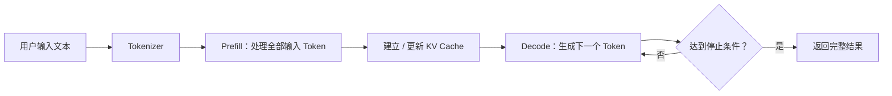
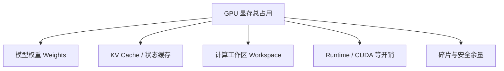
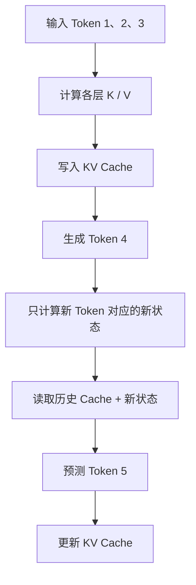
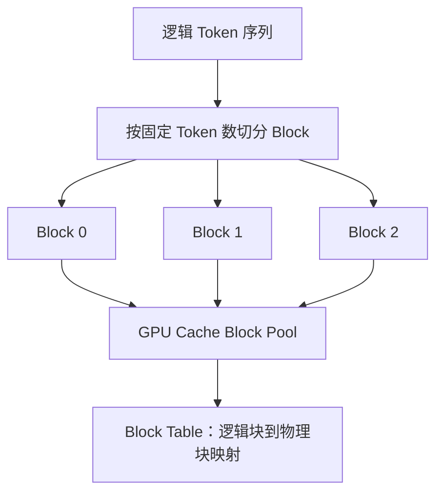

# 03 — 推理过程、显存与缓存技术

> 对应原方案：第 2、3、8、11 章  
> 学习目标：理解模型一次推理具体做了什么、为什么显存不仅被模型权重占用，以及 KV Cache、PagedAttention、Prefix Cache 等技术分别解决什么问题。

## 1. Inference（推理）是什么

Inference（推理）是使用已经训练好的模型，根据输入计算输出的过程。这里的“推理”不一定代表复杂逻辑推理；文本生成、分类、向量编码等模型运行都属于推理。

模型训练（Training）通常会更新模型参数；推理（Inference）通常使用固定权重执行前向计算，不更新基础模型权重。

## 2. 一次文本生成分成两个主要阶段

对于常见的自回归 Decoder-only LLM，可以把生成过程分成 Prefill 和 Decode。

### 2.1 Prefill（预填充阶段）

模型一次性处理当前输入提示词中的 Token，计算各层注意力表示，并建立后续 Decode 可复用的缓存状态。

特点：

- 输入 Token 通常可以并行处理。
- 输入越长，Prefill 计算工作通常越多。
- 会影响首 Token 延迟 TTFT。
- 对普通全注意力模型，会为输入上下文建立对应 KV Cache。

### 2.2 Decode（解码阶段）

模型在已有上下文基础上，自回归地生成后续 Token。通常每一步生成一个新 Token，再把它追加到上下文中，继续下一步。

特点：

- 新 Token 依赖之前的上下文。
- 每一步都要读取模型权重并使用历史缓存。
- 单请求的生成速度受计算、显存带宽、缓存访问和调度等影响。
- 输出越长，通常需要保存的请求状态越多。

## 3. 速度指标：TTFT、TPOT、TPS、Throughput

| 指标 | 全称 | 含义 | 用户感知 |
|---|---|---|---|
| TTFT | Time To First Token | 从请求到达至首个输出 Token 的时间 | 首次看到回答要等多久 |
| TPOT | Time Per Output Token | 输出阶段平均每个 Token 的耗时 | 后续文字出现的间隔 |
| Generation TPS | Tokens Per Second | 单个请求每秒生成的 Token 数 | 单个用户看到的生成速度 |
| Aggregate Throughput | 总吞吐量 | 系统单位时间处理的 Token 数 | 整个服务总体处理能力 |
| Queue Time | 排队时间 | 请求进入队列到开始执行的时间 | 请求等待多久才开始 |
| End-to-End Latency | 端到端延迟 | 从请求发出到完整响应结束的总时间 | 整个任务完成要多久 |

注意：

- TPS 这个缩写在不同工具中可能表示不同统计口径，必须写明是输入还是输出、单请求还是系统总量。
- TTFT 可能包含排队、调度、Prefill 等时间，具体计时边界以测试工具为准。
- TPOT 常用来衡量输出阶段每 Token 平均耗时；不同基准工具可能对首 Token、最后 Token 的处理不同。

## 4. GPU 显存（VRAM）是什么

GPU 显存是 GPU 可快速访问的专用内存。大模型推理通常需要将模型权重、缓存、计算工作区和运行时数据放在显存中，或者在显存与系统内存之间传输。

### 4.1 推理显存由什么组成

| 组成 | 作用 | 变化特点 |
|---|---|---|
| Model Weights | 存储模型参数 | 模型加载后通常长期占用 |
| KV Cache | 保存请求上下文的注意力状态 | 随活跃请求和上下文变化 |
| Workspace | Attention、矩阵运算等临时计算空间 | 受引擎、批次和输入形状影响 |
| Runtime | CUDA 上下文、内核、通信等运行开销 | 与运行环境和引擎有关 |
| Margin | 为波动和临时分配预留空间 | 需要实测确定 |

**关键结论：** 不能只用“参数量 × 量化位宽”判断模型能否加载或能否并发运行。

## 5. 模型权重占用估算

理论公式：

$$
M_{weights} \approx P \times \frac{q}{8}
$$

其中：

- $P$：参数数量。
- $q$：平均每参数位数。
- 结果为 Byte。

假设 7B 参数、平均 4 bit：

$$
7\times10^9\times\frac{4}{8}
=3.5\times10^9\text{ Bytes}
$$

这只是理论权重数据量。实际还可能有量化尺度、零点、分组元数据、未量化张量、对齐、词表和运行时缓冲区。

常见单位：

- 1 Byte = 8 bit。
- 1 KiB = 1024 Byte。
- 1 MiB = 1024 KiB。
- 1 GiB = 1024 MiB。

磁盘文件大小与实际 GPU 显存占用不一定相同。

## 6. KV Cache：键值缓存

### 6.1 它是什么

Transformer Attention 在处理 Token 时会产生 Key 和 Value 表示。自回归生成时，后续 Token 需要使用前面 Token 对应的 K/V 信息。

如果每生成一个 Token 都重新计算整个历史上下文，计算会大量重复。

KV Cache 就是把之前已经计算出的 K/V 状态保存起来，供后续 Token 使用。

### 6.2 KV Cache 不是什么

- 它不是模型权重。
- 它不是最终回答缓存。
- 它不是普通硬盘文件缓存。
- 它不是所有模型架构都完全相同的一块连续内存。

### 6.3 普通 Attention 的理论估算公式

对于每层都采用相同 KV 结构的标准全注意力模型，单条序列每个 Token 的 KV Cache 理论字节数：

$$
M_{KV/token}=2\times L\times H_{KV}\times D\times B
$$

其中：

| 符号 | 含义 |
|---|---|
| 2 | Key 和 Value 两份 |
| L | 需要保存该 KV 状态的层数 |
| H_KV | KV Head 数量 |
| D | 每个 Head 的维度 |
| B | 每个缓存元素的 Byte 数 |

FP16 / BF16 通常按 2 Byte 估算；FP8 / INT8 通常按 1 Byte 估算，但实际还要看引擎支持、缩放信息和对齐。

多条活跃序列：

$$
M_{KV,total}\approx
2\times L\times H_{KV}\times D\times B
\times\sum_{i=1}^{N}T_i
$$

其中 $T_i$ 是第 i 条序列当前缓存的 Token 数。

### 6.4 MHA / GQA / MQA 的数值示例

假设：

- Attention 层数 L = 32。
- Query Head = 64。
- Head Dimension = 128。
- 缓存精度 FP16，每元素 2 Byte。
- MHA 的 KV Head = 64；GQA 的 KV Head = 8；MQA 的 KV Head = 1。

| 结构 | KV Head | 每 Token 理论 KV | 32K Token 单序列 |
|---|---:|---:|---:|
| MHA | 64 | 1 MiB | 32 GiB |
| GQA | 8 | 128 KiB | 4 GiB |
| MQA | 1 | 16 KiB | 0.5 GiB |

GQA 示例：

$$
2\times32\times8\times128\times2
=131072\text{ Bytes}=128\text{ KiB}
$$

以上仅为公式教学示例，不代表某个实际模型。实际估算必须读取模型配置，并考虑滑动窗口、混合注意力、不同层结构、缓存精度和引擎实现。

### 6.5 MLA / Mamba / 混合架构

普通 KV 公式不能直接套用到所有模型：

- MLA：根据潜在 KV 表示维度、位置编码相关缓存和层结构计算。
- Mamba / DeltaNet 等状态空间或线性注意力结构：计算每层状态大小、状态精度和序列数。
- 混合架构：按每类层的缓存结构分别估算，再汇总。

因此原方案提出 CacheEstimator（缓存估算器），并且需要支持不同模型架构的专用估算策略。

## 7. PagedAttention：分页式 KV Cache 管理

PagedAttention 是 vLLM 提出的重要技术之一。它借鉴操作系统虚拟内存分页的思想，把 KV Cache 组织成固定大小的 Block（块），而不是要求每条请求都占据一整段连续的最大长度内存。

它主要改善：

- 缓存内存分配的灵活性。
- 连续大块内存分配要求。
- 不同长度请求之间的内部碎片。
- 多请求缓存块的管理和复用能力。

**不要误解：** PagedAttention 不会自动减少模型每个 Token 的理论 K/V 数值量。它改变的是缓存组织、分配和访问方式，实际收益取决于工作负载与实现。

## 8. Prefix Caching：前缀缓存

如果多个请求具有完全相同的 Token 前缀，系统可能复用此前已经计算的前缀 KV Cache，避免重复 Prefill。

例如多个 Agent 使用相同的系统提示词：

- 请求 A：系统提示词 + 用户问题 A。
- 请求 B：相同系统提示词 + 用户问题 B。

如果 Token 前缀完全匹配并且缓存仍然可用，B 可以复用 A 对应的共享前缀计算结果。

需要注意：

- 必须是 Token 级前缀匹配，不只是文字看起来相似。
- 模型、LoRA、位置、相关配置等条件可能影响缓存能否复用。
- 缓存可能被驱逐或失效。
- Prefix Cache 主要减少重复 Prefill，不意味着 Decode 自动变快。
- 多租户场景要考虑缓存隔离、访问权限和侧信道风险。

## 9. FlashAttention：高效 Attention 计算

FlashAttention 是一种 IO-aware（关注数据搬运成本）的精确 Attention 算法实现思路。

GPU 计算不只受算力影响，还受 HBM 等显存层级之间的数据读写影响。传统实现可能产生较多中间矩阵读写。

FlashAttention 通过分块（Tiling）和更合理的数据驻留方式，减少高成本显存读写，并避免完整物化某些巨大的中间矩阵。

它与 PagedAttention 的区别：

| 技术 | 主要解决问题 |
|---|---|
| FlashAttention | 如何更高效地计算 Attention，减少显存 IO |
| PagedAttention | 如何组织和管理推理时的 KV Cache 块 |
| KV Quantization | 如何降低缓存元素的存储精度和字节数 |
| Prefix Caching | 如何复用相同前缀已经计算的缓存 |

它们可以在同一个推理系统中配合，但不是同一种技术，也不能互相替代。

## 10. Quantization：量化

量化是把模型权重或缓存从较高精度表示转换为较低精度表示，以减少存储、显存或带宽需求，并可能提升推理效率。

### 10.1 常见精度

| 类型 | 大致位宽 | 常见用途 |
|---|---:|---|
| FP32 | 32 bit | 高精度计算或部分训练场景 |
| FP16 | 16 bit | 常见 GPU 推理精度 |
| BF16 | 16 bit | 动态范围特点适合部分训练/推理硬件 |
| FP8 | 8 bit | 部分新硬件和引擎支持的低精度计算/缓存 |
| INT8 | 8 bit | 权重量化或缓存量化 |
| INT4 | 4 bit | 更高压缩率的权重量化 |

这些精度不是简单地“越低越好”。量化算法、分组、缩放、硬件指令和模型结构都会影响效果。

### 10.2 权重量化 vs KV Cache 量化

- **权重量化：** 压缩模型参数，主要降低模型权重存储和读取成本。
- **KV Cache 量化：** 压缩推理过程中生成的缓存状态，主要降低长上下文和多并发的缓存占用。

两者作用对象不同，可以分别配置，但支持情况取决于引擎和模型。

### 10.3 量化的代价

- 数值精度降低可能导致模型质量下降。
- 不同量化方法对不同层的影响不一样。
- 某种量化格式存在，不代表当前 GPU 或推理引擎就能高效运行。
- 文件体积变小，不代表运行时所有显存占用都按同样比例下降。

## 11. Offload：卸载到其他存储层级

Offload 指把一部分模型权重或运行状态放到 GPU 显存以外的位置，例如系统 RAM，必要时再传到 GPU 使用。

常见类型：

- CPU Offload：把部分权重或缓存放在系统内存。
- Layer Offload：只把部分模型层放到 GPU，其他层留在 CPU。
- KV Offload：将部分 KV Cache 从 GPU 转移到 CPU 内存或其他存储层。

收益：在显存较小的设备上运行更大模型或更长上下文。

代价：CPU、GPU 之间的数据传输可能成为瓶颈，导致延迟和吞吐量下降。不能只看“能运行”，还要看实际速度是否可接受。

## 12. OOM：Out of Memory

OOM 是内存分配失败的统称。在本项目中通常重点关注 CUDA Out of Memory（显存不足）。

可能原因：

- 权重本身放不进显存。
- KV Cache 随上下文和并发增长。
- 引擎预分配了较大的缓存池。
- Prefill 工作区或批次过大。
- 其他程序占用显存。
- 多个模型或推理引擎同时加载。
- 资源管理器估算不准确。

处理顺序应当是测量和定位，而不是盲目把最大并发调低或把所有模型量化到最低精度。

## 13. 总显存预算

$$
M_{required}=
M_{weights}+M_{cache}+M_{workspace}+M_{runtime}+M_{margin}
$$

这是一种预算模型，不是所有引擎内部精确分配公式。实际需要结合引擎缓存池、显存预分配、CUDA 上下文和其他进程校准。

## 14. 本项目必须记住的结论

1. 权重和 KV Cache 是不同的显存组成。
2. 长上下文不仅增加文本输入量，也会增加 Prefill 计算和缓存需求。
3. 并发请求通常会增加同时驻留的缓存状态，但引擎缓存池的实际表现要看实现。
4. GQA/MQA/MLA 是模型架构设计，PagedAttention 是缓存管理技术。
5. FlashAttention 优化 Attention 计算中的数据读写，不是 KV Cache 分配器。
6. 量化可以降低存储需求，但要评估质量和速度。
7. 资源管理器需要使用模型结构、引擎指标和实测数据，而不能只按参数量估算。

## 15. 阅读检查

1. Prefill 和 Decode 分别做什么？
2. TTFT 和 TPOT 衡量什么？
3. KV Cache 为什么会随着上下文增长？
4. 为什么不能只按模型权重文件大小判断能否加载？
5. PagedAttention 与 FlashAttention 有什么区别？
6. 权重量化和 KV Cache 量化的对象有什么不同？
7. 为什么 MLA 需要专门的 Cache Estimator？
