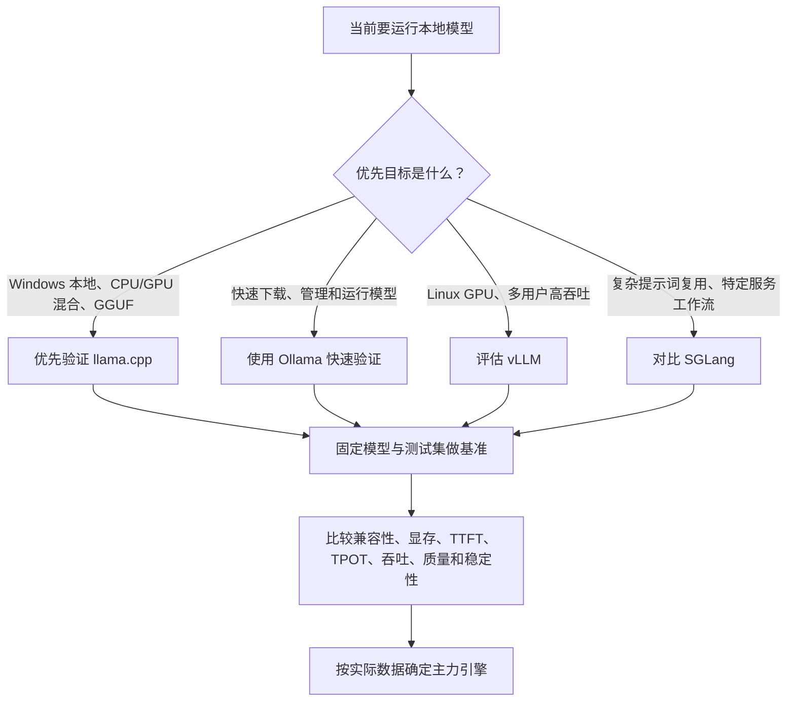

# 04 — 推理引擎与模型格式选型

> 对应原方案：第 5、6、10、15 章  
> 学习目标：理解 Ollama、llama.cpp、vLLM、SGLang 分别是什么，了解 GGUF、Safetensors 和量化格式，掌握本项目为什么按阶段选择引擎。

## 1. Inference Engine（推理引擎）是什么

推理引擎是负责加载模型并执行推理的运行软件。它通常需要处理：

- 读取模型配置、Tokenizer 和权重。
- 将模型结构映射到实际计算实现。
- 把权重和运行状态放入 GPU 或 CPU 内存。
- 执行 Prefill 和 Decode。
- 管理请求批次、缓存和内存。
- 提供服务接口或供上层服务调用的运行 API。

模型是“被运行的对象”，推理引擎是“负责运行它的系统”。

## 2. 四个候选引擎的定位

### 2.1 Ollama

**定位：** 方便用户下载、管理、运行和调用本地模型的工具与服务。

主要价值：

- 简化模型获取与运行流程。
- 提供模型列表、拉取、运行和删除等管理体验。
- 提供本地 HTTP API。
- 适合快速验证模型是否能在当前电脑运行。

适合：个人工作站、开发测试、快速切换模型、先建立可用的本地服务。

需要注意：

- 易用不代表一定是最高吞吐量方案。
- 并发、上下文和显存占用受模型、配置、运行器和硬件影响。
- 不应把 Ollama 的模型管理能力等同于完整的多模型 GPU 资源调度系统。
- 不同版本和平台的底层运行实现可能变化，不应把某一个版本的内部 Runner 结构当成永久架构。

官方入口：<https://ollama.com/>  
官方 FAQ：<https://github.com/ollama/ollama/blob/main/docs/faq.md>

### 2.2 llama.cpp

**定位：** 以 C/C++ 实现为核心的高效本地模型推理项目，尤其常用于 GGUF 模型。

主要价值：

- 支持 CPU 推理。
- 支持多种 GPU 后端和 CPU/GPU 混合卸载，具体取决于构建版本。
- 对 GGUF 模型生态支持成熟。
- 提供命令行和 Server 服务形态。
- 可用于消费级 GPU 和本地工作站。

适合：Windows 本地推理、量化模型、显存有限时的分层卸载、建立本地推理基线。

需要注意：

- GPU 加速能力取决于构建时启用的后端、驱动和硬件。
- 某模型架构是否支持，需要查对应版本的模型支持情况。
- CPU/GPU 混合运行通常以可运行性换取部分性能，必须实测。
- llama.cpp 是底层推理运行项目，不等同于完整的模型资产管理平台。

官方项目：<https://github.com/ggml-org/llama.cpp>

### 2.3 vLLM

**定位：** 面向高吞吐量和多请求服务的推理引擎。

主要价值：

- 面向 GPU 服务场景优化。
- 支持连续批处理（Continuous Batching）。
- 使用 PagedAttention 等机制管理 KV Cache。
- 支持前缀缓存等优化能力。
- 提供 OpenAI 兼容服务接口和丰富的运行指标。

适合：Linux GPU 服务、多个用户并发访问、需要压测和服务化的场景。

需要注意：

- 不是“安装后任何模型和显卡都能直接使用”。
- 模型架构、GPU、CUDA、PyTorch、驱动和 vLLM 版本必须兼容。
- 对消费级 Windows 原生环境通常不如 Linux/WSL2 路线直接；具体以当前官方支持矩阵为准。
- 高吞吐不代表单用户首 Token 延迟在所有场景都最低。

官方文档：<https://docs.vllm.ai/>

### 2.4 SGLang

**定位：** 面向高性能模型服务和复杂 LLM 工作流的推理系统。

主要价值：

- RadixAttention 等前缀状态复用机制。
- 面向复杂提示词和结构化生成场景的运行能力。
- 支持多种服务优化和模型执行路径。
- 适合与 vLLM 做同模型、同硬件、同工作负载对比。

适合：重复前缀较多、复杂 Agent / 多轮工作流、特定模型架构和高性能服务场景。

需要注意：

- 并非所有工作负载都一定优于 vLLM。
- 模型、硬件和版本兼容性仍需逐项确认。
- 不应在 P0 阶段为了“技术齐全”就同时部署多个高性能引擎。

官方文档：<https://docs.sglang.ai/>

## 3. 四个引擎的对比

| 维度 | Ollama | llama.cpp | vLLM | SGLang |
|---|---|---|---|---|
| 主要定位 | 易用的模型运行与管理 | 轻量灵活的本地推理 | 高吞吐 GPU 服务 | 高性能服务与复杂工作流 |
| 常见部署 | Windows / macOS / Linux | Windows / Linux / macOS 等 | 以 Linux GPU 环境为主 | 以 Linux GPU 环境为主 |
| CPU 推理 | 支持，取决于模型与运行器 | 核心优势之一 | 非主要使用方向 | 非主要使用方向 |
| CPU/GPU 混合 | 视运行器与配置 | 常见能力 | 取决于支持路径 | 取决于支持路径 |
| GGUF | 依支持的模型和导入路径 | 核心生态 | 非主要原生格式 | 非主要原生格式 |
| 高并发服务 | 可用，需按场景验证 | 支持一定并发能力 | 重点优势 | 重点优势 |
| 缓存优化 | 由版本和运行器能力决定 | 有自身缓存与批处理实现 | PagedAttention、Prefix Cache 等 | RadixAttention 等 |
| 上手难度 | 低 | 中 | 较高 | 较高 |
| V1.0 规划 | 快速模型管理 | P0 主力候选 | P1 高吞吐实验 | P2 对比候选 |

**结论不是“谁最好”，而是“谁适合哪种任务”。**

## 4. 为什么原方案先选择 llama.cpp + Ollama

两者在初期承担不同角色：

- llama.cpp：建立可控的 GGUF 本地推理和 Server 基线。
- Ollama：便于快速获取、运行和切换模型，减少验证成本。

这并不意味着必须同时让两个大模型常驻 GPU。对于单张 16GB 显存的工作站，初期应避免多个大模型服务同时占满显存。

后续再引入 vLLM 和 SGLang，是为了验证高并发和服务吞吐能力，不是因为它们在所有单机使用场景都优于 llama.cpp。

## 5. 模型格式与推理引擎不是一回事

模型格式是模型权重、配置或张量的保存方式；推理引擎负责读取受支持的格式并运行模型。

| 名称 | 类型 | 主要含义 |
|---|---|---|
| GGUF | 模型文件格式 | llama.cpp 生态常用，可包含张量和模型元数据 |
| Safetensors | 张量序列化格式 | 用于保存张量数据，强调安全加载设计 |
| PyTorch Checkpoint | 框架相关权重文件 | 常见于训练和研究工作流，具体格式需确认 |
| Model Config | 模型配置 | 描述层数、维度、注意力结构等参数 |
| Tokenizer Files | 分词器文件 | 定义词表和文本到 Token ID 的转换 |
| Model Card | 模型说明卡 | 记录用途、限制、训练信息和许可证等 |

### 5.1 GGUF

GGUF 是一种面向模型推理分发的文件格式，常见于 llama.cpp 生态。它可以存储模型张量和必要的元数据，方便推理程序读取。

它不是模型架构，也不是量化算法。一个 GGUF 文件可能包含不同量化类型的张量。

### 5.2 Safetensors

Safetensors 是一种用于保存张量的文件格式，强调加载时避免传统 pickle 反序列化带来的任意代码执行风险。

它不是推理引擎，也不代表模型一定是 FP16。具体张量可以是不同数据类型。

### 5.3 文件格式如何影响选型

- 想用 llama.cpp 的 GGUF 路线，应确认目标模型存在兼容 GGUF 版本。
- 使用 Hugging Face Transformers / PyTorch 工作流时，常见权重形式是 Safetensors 等。
- vLLM、SGLang 对模型文件格式和模型架构有各自支持范围，不能仅凭文件后缀判断一定能运行。
- 同一模型的不同量化版本，质量、显存和速度可能不同。

## 6. 量化格式名称如何看

例如 GGUF 文件名中可能出现 Q4_K_M、Q5_K_M、Q8_0 等名称。

这些名称通常表示某种量化类型或混合张量精度方案：

- Q：量化类型前缀。
- 数字：通常表达主要量化位宽等级，但不能把它简单理解为每个张量都严格只有这么多 bit。
- K：与特定分组/块量化方案有关。
- M：常表示某种混合精度变体标记。

不同项目和格式对命名有各自定义。必须查看对应量化实现的说明，不能只按文件名推断精确显存和质量。

另外还会看到：

- GPTQ：一种常见的权重量化方法/格式生态。
- AWQ：Activation-aware Weight Quantization，利用激活信息指导权重量化。
- bitsandbytes：提供低比特量化等能力的工具库。
- FP8 / INT8 / INT4：数值表示精度类别，不等于某一个具体量化算法。

## 7. 推理引擎选择决策树

## 8. 选型时必须比较哪些指标

不要只比较“能否启动”或单次生成速度。至少比较：

1. 模型架构支持情况。
2. 模型文件格式和量化支持。
3. GPU、驱动、CUDA 和操作系统兼容性。
4. 权重显存、缓存池显存和峰值显存。
5. TTFT、TPOT、单请求 TPS。
6. 多并发时的总吞吐量和 P95 延迟。
7. Prefix Cache 命中效果。
8. 稳定性、OOM、错误率和资源释放情况。
9. API 兼容性、运维复杂度和升级成本。

## 9. 本项目建议顺序

- **P0：** llama.cpp 建立本地 GGUF 推理基线；Ollama 用于模型管理和快速验证。
- **P1：** 资源监控和压测基础建立后，再配置 vLLM。
- **P2：** 选取相同模型和工作负载，与 SGLang 做公平对比。
- 不要在初期同时维护四套引擎的复杂配置。
- 每个引擎都必须记录版本、启动参数、模型哈希、硬件和测试结果。

## 10. 阅读检查

1. 模型格式与推理引擎有什么区别？
2. 为什么 Ollama 和 llama.cpp 不是完全相同抽象层级的产品？
3. 为什么 vLLM 不应只凭“高吞吐”就被选为 Windows 工作站的第一引擎？
4. GGUF 和 Safetensors 各是什么？
5. Q4_K_M 是否意味着所有模型张量都精确使用 4 bit？
6. 为什么四个引擎不应在第一阶段全部同时部署？
