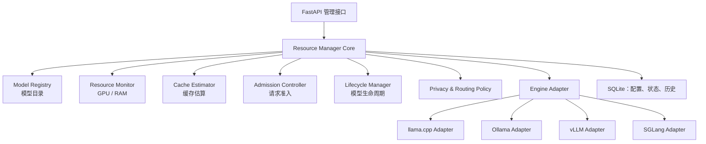
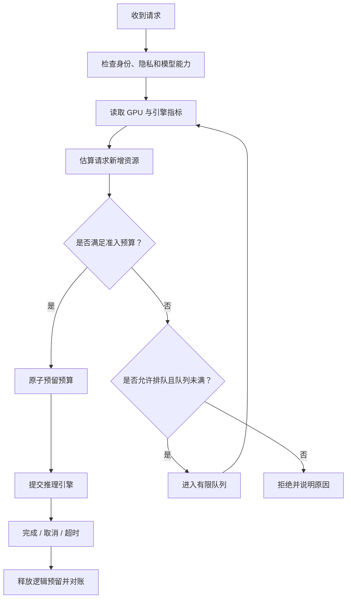
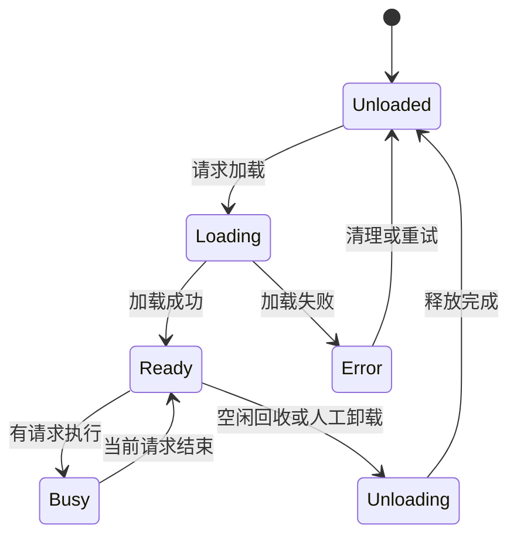

# 05 — 资源管理器与请求调度

> 对应原方案：第 7、8、9、11、13 章  
> 学习目标：理解自研 Resource Manager 为什么存在、各模块做什么，以及如何在不重写推理引擎的前提下管理 GPU 资源和请求。

## 1. Resource Manager 是什么

Resource Manager（资源管理器）是本地 AI 推理平台中的控制服务。它不负责模型的矩阵计算，而是观察系统和推理引擎状态，维护资源预算，并决定请求是否可以安全提交。

可以把它理解为“调度与资源管理的大脑”，而推理引擎是“真正执行计算的机器”。

它需要回答：

- 当前有哪些 GPU？每张卡有多少显存？
- 当前运行哪些模型实例？
- 某个模型使用哪种架构和缓存估算方法？
- 新请求需要多少输入上下文和输出预算？
- 是否有足够容量接收请求？
- 如果容量不足，是排队、拒绝还是要求用户授权云端处理？
- 模型何时加载、卸载或健康检查？

## 2. 自研模块总体结构



## 3. Python 3.12：为什么用 Python

Python 是本项目资源管理服务的主要开发语言，原因是：

- AI 工具和数据处理生态丰富。
- 有 FastAPI、Pydantic、PyTorch、Transformers 等成熟库。
- 适合实现管理 API、模型元数据处理、容量估算和自动化任务。
- 便于与 NVIDIA 管理接口及推理服务交互。

Python 不负责 GPU 底层计算内核；真正的模型计算由推理引擎和底层 GPU Kernel 完成。

## 4. FastAPI：把管理能力变成 HTTP 接口

FastAPI 是 Python Web API 框架。它可以把资源管理器的函数包装成可通过 HTTP 调用的接口。

例如：

| HTTP 方法 | 路径示例 | 用途 |
|---|---|---|
| GET | /api/gpu/status | 查询 GPU 状态 |
| GET | /api/models | 查询模型目录 |
| POST | /api/models/load | 请求加载模型 |
| POST | /api/models/unload | 请求卸载模型 |
| POST | /api/admission/check | 评估请求准入 |
| GET | /api/tasks | 查询任务状态 |

HTTP 方法含义：

- GET：读取资源。
- POST：提交操作或创建任务。
- PUT / PATCH：更新资源或配置。
- DELETE：删除资源。

这些是接口设计示例，不代表当前已经实现。真正部署时还需要认证、权限、参数验证和错误处理。

官方文档：<https://fastapi.tiangolo.com/>

## 5. Pydantic：数据验证和结构定义

Pydantic 是 Python 数据验证与数据建模库。它可把外部 JSON 请求转换为结构化对象，并检查字段类型、必填项和约束。

例如，一个加载模型请求可能包含：

```json
{
  "model_id": "local-code-model",
  "max_context_tokens": 8192,
  "max_output_tokens": 1024,
  "priority": "normal"
}
```

Pydantic 可以帮助检查：

- model_id 是否存在且格式正确。
- Token 数是否为合法整数。
- priority 是否属于允许的值。
- 是否遗漏必填字段。

它不会自动判断显存是否足够，也不会替代业务层的容量计算。

官方文档：<https://docs.pydantic.dev/>

## 6. NVML 与 pynvml：如何读取 NVIDIA GPU 状态

### 6.1 NVML 是什么

NVML（NVIDIA Management Library）是 NVIDIA 提供的管理与监控接口，可读取 GPU 的设备信息和运行状态。

常见数据：

- GPU 名称和设备编号。
- 总显存、已用显存和空闲显存。
- GPU 利用率。
- 温度和功耗。
- 部分进程的显存使用信息（受平台、驱动和权限限制）。

### 6.2 pynvml 是什么

pynvml 是 Python 调用 NVML 的接口封装。它让 Python 程序能够读取 NVML 暴露的部分能力。

二者关系：

- NVML：底层管理 API。
- pynvml：Python 代码调用 NVML 的封装。

### 6.3 NVML 不能告诉我们什么

NVML 可以报告设备和进程层面的显存状态，但它通常不能直接回答：

- 推理引擎的 KV Cache Block Pool 还剩多少可用块？
- 下一个请求一定能否进入引擎？
- 某个模型的完整 CacheEstimator 预算是多少？
- 引擎内部是否已经预留了未来请求的空间？

因此需要同时读取引擎自身指标，并对模型结构和请求长度进行估算。

官方资料：<https://developer.nvidia.com/management-library-nvml>

## 7. Model Registry：模型注册中心

Model Registry 是平台维护的模型元数据目录。它不是模型文件仓库，也不是模型下载器，而是记录模型“是什么、在哪里、如何运行、具备什么能力”。

建议字段：

| 字段 | 含义 |
|---|---|
| model_id | 平台内部唯一标识 |
| display_name | 展示名称 |
| family | 模型家族 |
| architecture | 架构类型，例如 Dense、MoE、GQA |
| parameter_size | 参数规模 |
| format | GGUF、Safetensors 等 |
| quantization | 量化类型 |
| context_length | 模型上下文能力 |
| task_capabilities | chat、code、embedding、vision 等能力 |
| engine_type | llama.cpp、Ollama、vLLM 等 |
| endpoint | 实际服务地址 |
| cache_estimator | 对应的缓存估算策略 |
| privacy_level | 数据处理等级 |
| status | unloaded、loading、ready、error 等状态 |

注册数据必须来自模型配置、模型卡、文件元数据和引擎实际加载信息，不能凭模型名称猜测。

## 8. Engine Adapter：推理引擎适配器

Adapter（适配器）是一种软件设计模式：把不同系统的接口包装成统一的内部接口。

例如：

- llama.cpp 可能提供自己的 Server API。
- Ollama 有自己的本地 API。
- vLLM 提供 OpenAI 兼容服务及管理指标。
- SGLang 有自己的服务接口和运行状态。

资源管理器不应把每种引擎的特殊调用散落在所有业务代码中，而应定义统一接口，例如：

- health_check()：检查服务健康。
- list_models()：查询模型。
- load_model()：请求加载模型（仅在引擎支持相应控制时）。
- unload_model()：请求卸载模型（仅在引擎支持相应控制时）。
- get_metrics()：读取引擎指标。
- get_runtime_status()：获取运行状态。

适配器只是统一接口，不代表每个引擎都支持完全相同的加载、卸载和缓存控制能力。必须按引擎逐项实现和标注能力。

## 9. Cache Estimator：缓存估算器

Cache Estimator 根据模型架构和请求参数估算推理时的缓存需求。

输入可能包括：

- 模型层数。
- KV Head 数。
- Head Dimension。
- 缓存数据类型。
- 当前上下文 Token 数。
- 最大输出 Token 预算。
- 活跃请求数量。
- 滑动窗口、MLA 或混合注意力结构。

输出是一个**估算值或范围**，不是引擎最终分配结果。

为什么要按架构实现不同 Estimator？

- 普通 MHA/GQA 可使用标准 KV 公式。
- MLA 需要潜在表示和位置相关缓存的专用计算。
- Mamba / DeltaNet 需要按状态结构估算。
- 混合模型要按不同层的缓存类型汇总。

建议接口概念：

```python
class CacheEstimator:
    def estimate(self, model_config, request_config):
        """返回估算缓存需求、假设和不确定性范围。"""
        raise NotImplementedError
```

这里是接口示意，不是可直接运行的完整实现。

## 10. Admission Control：请求准入控制

Admission Control 的意思是：请求进入推理执行前，先判断当前系统是否有能力接收它。

它不是简单的“看一下显存剩余量”。需要综合考虑：

- 模型是否已加载。
- 模型权重是否已占用资源。
- 引擎缓存池是否还有容量。
- 输入 Token 和最大输出 Token 预算。
- 当前活跃请求和排队请求。
- GPU、CPU、RAM 的压力。
- 用户优先级、超时和隐私策略。

### 10.1 三种基本结果

| 结果 | 含义 | 适用条件 |
|---|---|---|
| Accept | 接受并执行 | 容量和策略均允许 |
| Queue | 进入有限队列等待 | 暂时无容量，但允许等待 |
| Reject | 拒绝并返回原因 | 超过容量、策略禁止或不满足要求 |



### 10.2 为什么需要原子预留

错误做法：

1. 请求 A 读取空闲预算：4GB。
2. 请求 B 同时读取空闲预算：4GB。
3. A 判断需要 3GB，可以执行。
4. B 也判断需要 3GB，可以执行。
5. 两个请求都提交后，总需求超过预算。

这就是并发竞争（Race Condition）。

正确方向：

- 对平台内部的逻辑预算使用原子更新或锁。
- 一个请求成功预留后，其他请求必须看到更新后的预算。
- 请求完成、取消、超时、提交失败时，正确释放预留。
- 定期与引擎实际状态对账。

**非常重要：** 逻辑预留不是直接在 GPU 上创建一块真实显存。真正的缓存分配仍由推理引擎控制。资源管理器需要通过受控入口协调请求，并用引擎指标验证结果。

## 11. Scheduler：调度器

Scheduler（调度器）决定任务什么时候、在哪个可用实例上执行。

可能考虑：

- 模型能力是否匹配。
- 模型是否已经加载。
- 请求优先级。
- 预计等待时间。
- GPU 资源。
- 用户配额。
- local-only 等隐私要求。

调度策略可能包括：

- FIFO：先进先出。
- Priority Queue：优先级队列。
- Least Loaded：选择负载较低的实例。
- Affinity：尽量让请求使用已经加载目标模型的实例。

调度不是随意切换模型。切换模型可能需要卸载、加载、重新分配显存，造成明显延迟。

## 12. Concurrency、Queue 与 Backpressure

| 术语 | 中文 | 解释 |
|---|---|---|
| Concurrency | 并发 | 同一时间有多个任务处于执行中 |
| Parallelism | 并行 | 多个任务在同一时刻实际同时计算 |
| Queue | 队列 | 暂时保存等待执行的请求 |
| Backpressure | 背压 | 下游处理能力不足时，向上游施加限制 |
| Rate Limit | 限流 | 限制单位时间内的请求数量或 Token 数 |
| Timeout | 超时 | 请求等待或执行超过设定时间 |
| Cancellation | 取消 | 用户或系统终止任务 |
| Race Condition | 竞态条件 | 多个任务的执行顺序影响结果，产生竞争问题 |

并发不等于真正的 GPU 并行。多个请求可以同时排队或处于执行状态，但 GPU 会通过批处理和调度共享计算资源。

## 13. Model Lifecycle Manager：模型生命周期管理

模型状态通常包括：



常见术语：

- Load：加载模型权重和运行环境。
- Warm-up：预热，先运行少量请求，让内核或缓存准备好。
- Health Check：健康检查。
- Idle Timeout：空闲超时。
- Eviction：驱逐或回收模型资源。
- Unload：卸载模型并释放资源。

需要考虑：

- 有活跃请求时不能随意卸载。
- 加载失败要回滚状态并释放已分配资源。
- 卸载不一定瞬间完成。
- 其他进程可能继续占用显存。
- 模型加载时间也应纳入用户体验指标。

## 14. SQLite 与 Redis 在资源管理中的位置

### SQLite

SQLite 是嵌入式关系型数据库，数据通常存储在本地文件中。适合单机初期保存模型目录、配置、实验记录和任务历史。

优点：无需独立数据库服务，部署简单。

限制：并发写入能力和多进程访问方式需要合理设计；不适合未经评估就当作大规模分布式任务队列。

### Redis

Redis 是以内存数据结构为核心的服务，可用于缓存、计数、队列、分布式锁和多进程共享状态。

初期单机、单控制进程可以先用 asyncio、进程内协调和 SQLite。只有出现多进程协调、跨服务共享状态、可靠队列等明确需求时，再评估 Redis。

## 15. 本项目实现顺序

建议 PHASE 02 按以下顺序落地：

1. GPU / RAM 状态采集。
2. 模型注册结构和数据校验。
3. Engine Adapter 与健康检查。
4. 基于模型结构的 Cache Estimator。
5. 单 GPU、单引擎的 Admission Controller。
6. 有上限的请求队列、取消和超时。
7. 模型生命周期管理。
8. 原子预留、故障恢复和资源对账。
9. 隐私策略与审计记录。

先完成单 GPU、单引擎闭环，再扩展多模型、多 GPU 和分布式协调。

## 16. 阅读检查

1. Resource Manager 为什么不应该自己实现 Attention 内核？
2. NVML 为什么不能直接告诉我们 KV Cache 还能容纳多少 Token？
3. Model Registry 和模型文件仓库有什么区别？
4. Engine Adapter 的价值是什么？
5. 为什么请求准入必须考虑原子预留？
6. 逻辑资源预留是否等于真正锁定 GPU 显存？
7. 什么情况下才值得引入 Redis？
