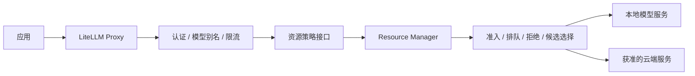

# 06 — API 网关与基础软件组件

> 对应原方案：第 6、7、10、13 章  
> 学习目标：理解 API、SDK、REST、OpenAI 兼容接口、LiteLLM、FastAPI、SQLite、Redis 等基础组件的职责和边界。

## 1. API 是什么

API（Application Programming Interface，应用程序接口）是软件之间约定如何互相调用的规则。

例如，桌面应用不需要知道推理引擎内部怎么运行，只需要按接口发送请求：

- 请求发到哪个地址？
- 使用什么 HTTP 方法？
- 请求参数有哪些？
- 如何认证？
- 返回什么数据结构？
- 发生错误时返回什么？

API 就是这些调用规则的集合。

## 2. HTTP、REST API 和 Endpoint

### HTTP

HTTP 是客户端和服务器交换数据的应用层协议。常见方法：

| 方法 | 常见用途 |
|---|---|
| GET | 读取数据 |
| POST | 创建任务、提交请求 |
| PUT | 整体更新资源 |
| PATCH | 部分更新资源 |
| DELETE | 删除资源 |

### REST API

REST 是一种 API 设计风格，通常使用资源路径和 HTTP 方法表达操作。现实中很多服务会称自己为 REST API，但具体是否严格遵循 REST 约束需要看实际设计。

### Endpoint

Endpoint（端点）是具体可调用的接口地址，例如：

`http://127.0.0.1:4000/v1/chat/completions`

它包含服务地址和路径。实际使用时还要考虑 HTTP/HTTPS、端口、认证和网络绑定。

## 3. SDK 是什么

SDK（Software Development Kit，软件开发工具包）是为了方便开发者调用某个服务或平台而提供的一组库、工具和示例。

例如 Python SDK 可以把底层 HTTP 请求封装成：

```python
client.chat.completions.create(
    model="local-chat",
    messages=[{"role": "user", "content": "你好"}]
)
```

如果没有 SDK，也可以使用 requests、httpx 或原生 HTTP 客户端直接请求 API。

区别：

- API 是服务对外提供的调用规则。
- SDK 是客户端帮助开发者使用这些规则的工具。
- SDK 不等于服务本身，也不代表模型在本地运行。

## 4. OpenAI-compatible API：兼容接口是什么意思

OpenAI-compatible API 表示某个服务实现了与 OpenAI API 相似或兼容的一组请求和响应格式。

本地应用如果使用兼容接口，通常只需要调整：

- base_url：API 服务地址。
- api_key：当前服务要求的密钥。
- model：网关识别的模型名称或别名。

就可以把原来调用云端模型的代码切换到本地服务。

但“兼容”不是“所有功能完全一致”：

- 不同服务支持的接口端点可能不同。
- 参数、工具调用、JSON 模式、流式行为可能有差异。
- 错误格式和使用量统计也可能不同。
- 多模态能力要逐项核实。

因此应用必须针对实际使用的功能做兼容性测试。

## 5. LiteLLM：统一模型 API 与代理

LiteLLM 提供 Python SDK 和 Proxy 服务能力，可以把不同模型提供方的接口统一到相近的调用方式，并提供模型路由、虚拟密钥、限流、重试、回退和用量记录等能力。

本项目重点使用 LiteLLM Proxy 作为统一模型 API 入口。

### 5.1 关键术语

| 术语 | 解释 | 例子 |
|---|---|---|
| Proxy | 代理服务 | 接收应用请求后转发到模型服务 |
| Model Alias | 模型别名 | local-code 指向实际代码模型部署 |
| Provider | 模型提供方/后端 | 本地 Ollama、vLLM 或云端服务 |
| Deployment | 一条具体模型部署配置 | 模型名、后端地址和参数 |
| Routing | 路由 | 决定请求发给哪个部署 |
| Load Balancing | 负载均衡 | 多个可用实例之间分配请求 |
| Retry | 重试 | 请求失败后按策略再次尝试 |
| Fallback | 备用回退 | 主模型不可用时切换备用模型 |
| Virtual Key | 虚拟密钥 | 给不同应用或团队分配独立调用凭证 |
| RPM | Requests Per Minute | 每分钟请求数限制 |
| TPM | Tokens Per Minute | 每分钟 Token 数限制 |
| Usage Tracking | 用量记录 | 记录请求量、Token 和模型使用情况 |

### 5.2 LiteLLM 不负责什么

- 不执行模型的 GPU 矩阵计算。
- 不天然知道 NVML 显示的空闲显存能否安全分配给 KV Cache。
- 不自动替代自研 Model Registry。
- 不自动保证所有引擎的加载、卸载行为一致。
- 不应在没有隐私策略检查时自动把敏感请求回退到云端。

### 5.3 本项目中的分工



真正集成时需要设计清晰的同步边界：资源检查应在请求提交引擎前完成，资源预留、提交失败、取消和完成都要有状态管理。不能只靠一个异步监控脚本就宣称实现了严格准入。

官方文档：<https://docs.litellm.ai/>

## 6. FastAPI 与 LiteLLM 的区别

二者都可以提供 HTTP API，但用途不同：

| 对比 | FastAPI | LiteLLM Proxy |
|---|---|---|
| 类型 | Python Web API 框架 | LLM API 代理与管理服务 |
| 主要用途 | 开发自定义业务接口 | 统一调用不同模型服务 |
| GPU 监控接口 | 可以由我们编写 | 不是其核心职责 |
| 模型路由 | 需要自行实现 | 提供模型路由能力 |
| 数据验证 | 常配合 Pydantic | 有自身配置与验证机制 |
| 本项目用途 | 自研 Resource Manager API | 统一模型调用入口 |

简单理解：

- LiteLLM：负责“模型调用入口”。
- FastAPI：负责“我们自己开发的资源管理接口”。

## 7. Pydantic：配置与数据校验

Pydantic 通过 Python 类型定义描述数据结构，并验证外部输入。

例如：

- 请求必须包含 model_id。
- max_output_tokens 必须为正整数。
- privacy_level 必须是允许的枚举值。
- 模型配置的字段必须符合结构。

它可以减少无效输入，但不能替代业务规则和资源判断。

## 8. SQLite：初期持久化数据库

SQLite 是嵌入式关系型数据库，通常不需要单独启动数据库服务，数据保存在本地文件中。

适合保存：

- 模型注册信息。
- 系统配置。
- 模型加载历史。
- 请求任务记录。
- 实验与压测结果索引。
- 路由和策略配置。

优点：

- 部署简单。
- 单机应用使用方便。
- 数据文件易备份。
- 初期运维成本低。

限制：

- 写入并发能力有限，需要理解事务和锁。
- 不适合直接承担高并发分布式任务协调。
- 多个进程同时写入时要处理锁等待和超时。
- 备份时要考虑 WAL 等运行模式。

## 9. Redis：什么时候需要引入

Redis 是一个内存数据结构服务，常用于缓存、计数器、队列、发布订阅和分布式协调。

本项目可能使用它保存：

- 多个 Resource Manager Worker 共享的任务状态。
- 分布式锁或租约。
- 短期缓存和限流计数。
- 多进程之间的队列或协调信息。

但 Redis 不是初期必需组件。若当前只有一个控制服务进程，先用进程内机制和 SQLite 可能更简单。

引入 Redis 的条件应是明确的工程需求，例如多进程共享状态、跨服务协调或队列能力，而不是“成熟架构都应该有 Redis”。

官方文档：<https://redis.io/docs/latest/>

## 10. Async、Thread、Process：异步、线程和进程

| 名称 | 解释 | 适用场景 |
|---|---|---|
| Async / Await | 异步编程模型，等待 I/O 时让出执行权 | 同时处理多个 HTTP 请求 |
| Thread | 线程，共享同一进程内存空间 | I/O、部分并发任务 |
| Process | 进程，有独立地址空间 | 隔离运行服务、利用多核 |
| Event Loop | 事件循环 | 调度异步任务 |
| Lock | 锁 | 保护共享状态 |
| Semaphore | 信号量 | 限制同时进入某段代码的任务数量 |

异步不等于并行计算。FastAPI 的异步接口可以提升 I/O 并发能力，但不会自动让 GPU 推理速度变快。

Python 的 GIL（Global Interpreter Lock，全局解释器锁）会影响部分 CPU 密集型 Python 字节码并行执行；但 GPU Kernel、I/O 等行为有不同执行机制。是否使用线程或进程应根据实际任务和库的行为决定。

## 11. Streaming：流式响应

流式响应指服务端在结果生成过程中分批发送数据，而不是等完整回答生成后再一次返回。

在常见 OpenAI 风格接口中，流式响应常通过 Server-Sent Events（SSE）传输。

好处：

- 用户更早看到首个 Token。
- 长回答不必等全部生成后才显示。
- 应用可以实时展示进度或处理部分内容。

需要注意：

- 流式响应不代表模型计算更快。
- 客户端需要正确处理分块、结束标记、异常和取消。
- 资源管理器需要处理客户端断开后的请求取消与资源释放。

## 12. API Key、Authentication、Authorization

- Authentication（认证）：确认“你是谁”，例如验证 API Key。
- Authorization（授权）：确认“你可以做什么”，例如是否允许调用某个模型。
- API Key：调用凭证，不能当作普通模型名称。
- Secret：敏感密钥或密码。
- RBAC：基于角色的访问控制。

管理接口中的模型卸载、配置修改等操作应限制权限，不能因为 API 可访问就允许所有调用者执行。

## 13. 本项目组件选型结论

| 需求 | 组件 | 选型理由 |
|---|---|---|
| 统一模型调用 | LiteLLM Proxy | 减少业务应用适配多个模型服务的工作 |
| 自定义资源 API | FastAPI | Python 生态、异步 API 和类型提示 |
| 请求结构校验 | Pydantic | 结构化验证 |
| 初期持久化 | SQLite | 单机简单、低维护 |
| 多进程协调 | Redis（按需） | 仅在实际出现共享状态需求时引入 |

## 14. 阅读检查

1. API 和 SDK 有什么区别？
2. OpenAI-compatible API 是否保证所有 OpenAI 功能都兼容？
3. LiteLLM 和 FastAPI 为什么不是二选一？
4. 为什么 LiteLLM 不等于 GPU Resource Manager？
5. SQLite 和 Redis 的定位有什么不同？
6. Async 是否意味着 GPU 并行计算？
7. Authentication 和 Authorization 分别解决什么问题？
