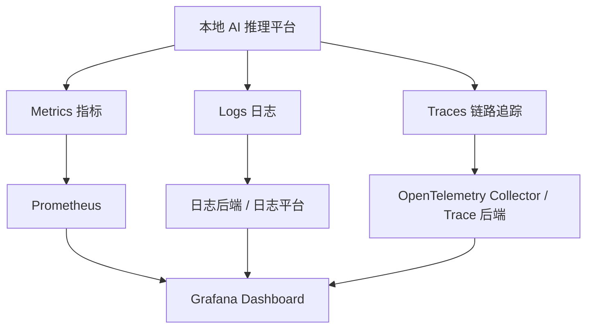

# 07 — 监控、性能评测、部署与安全

> 对应原方案：第 10、11、12、13、14、15 章  
> 学习目标：理解 Prometheus、Grafana、OpenTelemetry、GPU 硬件指标、性能压测、Windows/WSL2 部署和隐私边界。

## 1. Monitoring 与 Observability

Monitoring（监控）通常指持续采集系统状态并在异常时告警。

Observability（可观测性）更强调：当系统出现问题时，能否通过外部输出的数据理解内部发生了什么。

本项目至少需要关注三类信号：

- Metrics：指标。
- Logs：日志。
- Traces：链路追踪。

## 2. Metrics：指标

Metrics 是可以随时间采集和比较的数值数据，例如：

- GPU 显存使用 12 GiB。
- GPU 利用率 85%。
- 当前活动请求 3 个。
- KV Cache 使用率 72%。
- 请求失败率 0.5%。
- P95 TTFT 为 1.8 秒。

指标适合观察趋势、比较版本、触发告警。

## 3. Logs：日志

Log 是事件记录，常包含时间、级别、服务、请求 ID 和错误信息。

例如：

- 模型加载开始。
- 模型加载完成。
- 请求进入队列。
- CUDA 内存分配失败。
- 云端回退被隐私策略拒绝。

日志适合回答“某个时间点发生了什么”。

日志不应该默认保存完整敏感提示词、患者数据或上传文件内容。应按隐私策略做脱敏、最小化和访问控制。

## 4. Traces：链路追踪

Trace（追踪）用于描述一个请求跨越多个服务和组件的完整路径。Trace 通常由多个 Span（跨度）组成。

例如一次请求可能包含：

1. API 网关认证。
2. 模型路由。
3. 资源准入。
4. 引擎排队。
5. Prefill。
6. Decode。
7. 响应返回。

每个 Span 记录自己的开始、结束、属性和状态。这样可以知道时间究竟消耗在网关、排队还是推理阶段。

## 5. Prometheus：指标采集与时序数据

Prometheus 是开源监控与时序数据库系统。它通常通过定期抓取（Scrape）目标服务暴露的 Metrics Endpoint，存储带时间戳的指标样本，并使用 PromQL 查询。

关键术语：

| 术语 | 解释 |
|---|---|
| Scrape | 定期抓取指标 |
| Exporter | 将某个系统状态转换为 Prometheus 指标的组件 |
| Target | Prometheus 要抓取的目标 |
| Metric | 指标名称和样本 |
| Label | 指标的维度标签 |
| PromQL | Prometheus 查询语言 |
| Alert | 根据条件触发的告警 |

注意：Prometheus 主要用于 Metrics，不是完整的日志和 Trace 存储系统。

官方文档：<https://prometheus.io/docs/>

## 6. Grafana：可视化仪表盘

Grafana 用于连接数据源，把指标、日志或追踪数据展示为仪表盘、图表和告警视图。

例如本项目可以建立：

- GPU 总览：型号、显存、利用率、温度、功耗。
- 模型运行：已加载模型、加载耗时、健康状态。
- 请求情况：活动请求、等待请求、拒绝数。
- 推理性能：TTFT、TPOT、输入和输出 Token 速率。
- 缓存：KV Cache 使用率、Prefix Cache 命中率。
- 可靠性：OOM、错误率、超时和回退次数。

Grafana 本身不负责采集 GPU 数据；它需要连接 Prometheus 或其他数据源。

官方文档：<https://grafana.com/docs/>

## 7. OpenTelemetry：统一可观测性标准

OpenTelemetry（常写作 OTel）是一套开源的可观测性标准、API、SDK 和工具生态，用于生成、处理和导出 Metrics、Logs、Traces 等信号。

常见组成：

- API：定义如何埋点。
- SDK：具体生成和处理遥测数据。
- Instrumentation：自动或手动埋点。
- Collector：接收、处理和导出遥测数据。
- Exporter：把数据发送到指定后端。

它不是一个单独的可视化面板，也不等于 Prometheus。

简化理解：

- Prometheus：本项目主要用于指标采集和查询。
- Grafana：用于展示监控数据。
- OpenTelemetry：用于在应用和服务中统一产生、关联和传输遥测信号。

官方文档：<https://opentelemetry.io/docs/>

## 8. GPU 硬件相关术语

| 术语 | 中文 | 解释 |
|---|---|---|
| GPU | 图形处理器 | 大规模并行计算处理器 |
| VRAM | 显存 | GPU 使用的专用内存 |
| CUDA | NVIDIA 并行计算平台与编程模型 | 让程序使用 NVIDIA GPU 计算 |
| CUDA Runtime | CUDA 运行时 | 提供设备、内存、Kernel 等运行接口 |
| CUDA Driver | CUDA 驱动接口 | 与 NVIDIA 驱动层交互 |
| Tensor Core | 张量核心 | NVIDIA GPU 中用于加速矩阵/张量运算的专用单元 |
| SM | Streaming Multiprocessor | NVIDIA GPU 的主要计算单元组织 |
| HBM | High Bandwidth Memory | 高带宽显存技术，常见于数据中心加速器 |
| GDDR | Graphics DDR Memory | 常见于消费级显卡的显存类型 |
| PCIe | Peripheral Component Interconnect Express | CPU、GPU 等设备间的高速互连总线 |
| Memory Bandwidth | 内存带宽 | 单位时间可传输的数据量 |
| FLOPS | 每秒浮点运算次数 | 衡量计算能力的指标之一 |
| Utilization | 利用率 | 某资源在统计窗口内的繁忙程度 |

### 8.1 为什么显存带宽重要

大模型 Decode 阶段每生成一个 Token，通常需要访问大量模型权重和缓存。对于部分模型和批次规模，速度可能受显存带宽限制，而不只是受理论算力限制。

所以比较 GPU 时不能只看 CUDA 核心数或 FLOPS，还要看：

- 显存容量。
- 显存带宽。
- Tensor Core 能力。
- 支持的数据类型。
- 功耗和散热。
- 软件驱动与推理引擎支持。

### 8.2 CUDA 和 Tensor Core 的区别

- CUDA 是 NVIDIA 的 GPU 编程平台/生态名称。
- Tensor Core 是 GPU 内部执行特定矩阵运算的硬件单元。
- CUDA 程序可以通过相应库和 Kernel 使用 Tensor Core。
- 安装 CUDA Toolkit 不等于自动获得某个模型的最优推理性能。

## 9. 性能评测：为什么必须压测

“模型可以回答问题”只证明基本功能可用，不代表系统适合长期运行。

性能必须固定条件测试：

- GPU 型号、驱动和软件版本。
- 模型名称、文件哈希、量化。
- 推理引擎版本和启动参数。
- 输入 Token 数和输出上限。
- 并发数和请求分布。
- 是否启用 Prefix Cache。
- 其他程序是否占用 GPU。

### 9.1 P50、P95、P99 是什么

这些是百分位数（Percentile）：

- P50：50% 的样本不超过该值，可理解为中位数。
- P95：95% 的样本不超过该值。
- P99：99% 的样本不超过该值。

例如 100 次请求的 TTFT：

- P50 = 1 秒。
- P95 = 3 秒。
- P99 = 5 秒。

这意味着大多数请求较快，但仍有少数请求明显更慢。只报告平均值可能掩盖尾部延迟问题。

### 9.2 基准测试矩阵

| 测试 | 并发 | 输入长度 | 输出长度 | 目的 |
|---|---:|---:|---:|---|
| 单请求基线 | 1 | 2K | 256 | 观察单请求表现 |
| 并发 A | 2 | 2K | 256 | 初始并发影响 |
| 并发 B | 4 | 2K | 256 | 进一步观察吞吐与尾延迟 |
| 长上下文 A | 1 | 8K | 256 | 观察上下文增长 |
| 长上下文 B | 1 | 16K | 256 | 观察缓存压力 |
| 混合负载 | 2–4 | 2K–8K | 128–512 | 接近真实使用 |
| 前缀复用 | 2–4 | 相同系统前缀 | 256 | 观察 Prefix Cache 收益 |

这些只是测试档位，不是对 16GB GPU 的并发能力承诺。

## 10. CPU、RAM、GPU、VRAM、SSD 的关系

| 资源 | 作用 | 本项目关注点 |
|---|---|---|
| CPU | 操作系统、数据处理、部分模型计算 | 核心数、频率、指令集 |
| RAM | 系统内存 | CPU Offload、模型加载和缓存 |
| GPU | 并行计算 | 推理计算能力 |
| VRAM | GPU 专用内存 | 权重、KV Cache、工作区 |
| SSD / NVMe | 持久化存储 | 模型文件、缓存、数据集和日志 |

SSD 快不代表模型会自动在 SSD 上高效推理。若运行时需要从 SSD 频繁读取模型数据，通常会受到存储延迟和带宽限制。

## 11. Windows 11 与 WSL2

### Windows 11

适合日常开发、IDE、Python 环境、桌面工具以及支持 Windows 的本地推理引擎。

### WSL2

WSL2（Windows Subsystem for Linux 2）是在 Windows 中运行 Linux 环境的子系统，使用轻量化虚拟化技术。

本项目规划：

- Windows：日常开发、Ollama、llama.cpp 等本地测试。
- WSL2 Ubuntu：后续验证 Linux GPU 推理服务，例如 vLLM、SGLang。
- 两边可以访问同一块物理 NVIDIA GPU（需要正确驱动和支持配置）。

**关键注意：** Windows 和 WSL2 使用同一块物理 GPU 时，显存不是两份独立资源。Windows 上运行的其他 GPU 程序也可能影响 WSL2 内的模型服务。

官方文档：<https://learn.microsoft.com/windows/wsl/>

## 12. Docker：容器化是什么

Docker 用于把应用及其依赖封装在容器中，使部署环境更容易复现。

常见术语：

- Image：镜像，容器运行所依据的软件包。
- Container：容器，镜像启动后的运行实例。
- Volume：卷，用于持久化数据或挂载目录。
- Port Mapping：端口映射。
- Environment Variable：环境变量。
- Compose：通过配置管理多个容器服务。

容器化不是性能优化的同义词，也不是所有本地组件都必须容器化。GPU 容器还需要正确配置宿主机驱动和容器运行时。

## 13. 隐私等级与路由安全

原方案定义的数据等级：

| 等级 | 含义 | 路由约束 |
|---|---|---|
| local-only | 只能在本地处理 | 绝不进入外部云端候选 |
| private-network | 只能在指定私有网络处理 | 不得转到未批准的公网服务 |
| cloud-allowed | 经授权允许云端处理 | 仍需检查服务和数据合规 |
| public | 公开数据 | 按质量、速度和成本选择 |

需要理解：

- Privacy Policy：隐私策略，决定数据允许到哪里。
- Data Classification：数据分类，确定数据敏感级别。
- Authentication：认证，确认调用者身份。
- Authorization：授权，确认调用者能做什么。
- Audit Log：审计日志，记录谁在什么时间执行了什么操作。
- Secret Management：密钥管理，保护 API Key 和凭证。

**安全原则：** local-only 必须在路由候选选择之前生效。不能先选云端模型，再试图靠日志或提示词限制数据泄露。

## 14. 监控与告警应观察什么

| 指标 | 发现的问题 |
|---|---|
| GPU VRAM Used / Free | 显存是否接近容量上限 |
| GPU Utilization | GPU 是否繁忙或利用不足 |
| Temperature / Power | 温度、功耗和稳定性 |
| KV Cache Usage | 引擎缓存池是否紧张 |
| Active / Waiting Requests | 当前执行和等待任务数 |
| TTFT / TPOT | 用户等待和生成速度 |
| Queue Time | 是否因资源不足长时间排队 |
| OOM Count | 显存分配失败 |
| Error Rate | 请求失败比例 |
| Prefix Cache Hit | 前缀缓存是否产生收益 |
| Cloud Fallback Rate | 云端回退频率与成本风险 |

指标名称和采集方式取决于具体引擎版本。Prometheus 不会自动知道所有这些数据，必须由引擎暴露、Exporter 采集或应用埋点提供。

## 15. 阅读检查

1. Metrics、Logs、Traces 分别回答什么问题？
2. Prometheus 和 Grafana 分别做什么？
3. OpenTelemetry 是不是一个仪表盘？
4. 为什么 GPU 利用率高不一定代表吞吐量最优？
5. 为什么需要同时记录 P50 和 P95？
6. WSL2 与 Windows 是否拥有独立的物理 GPU 显存？
7. 为什么 local-only 必须在路由选择之前执行？
