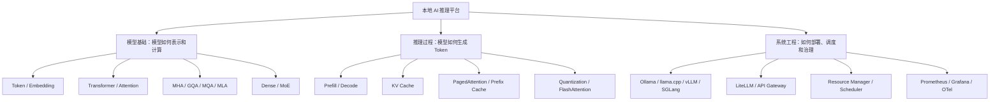

# 本地 AI 推理引擎：技术术语与原理手册

> **用途：** 配合《本地 AI 推理引擎：技术架构与落地方案 V1.0》阅读，解释方案中的专业术语、技术原理、组件职责和选型依据。  
> **基准方案：** `AI-Model-Development/docs/本地AI推理引擎-技术架构与落地方案-V1.0.md`  
> **版本：** V1.0  
> **建立日期：** 2026-11-26  
> **文档性质：** 学习与开发参考手册，不代表相关组件已经安装或通过性能验收。

---

## 1. 为什么建立这套手册

原技术方案面向工程落地，包含模型架构、推理引擎、GPU 显存、缓存、API 网关、资源调度、监控和安全等多个专业领域。

本手册的目标不是简单翻译英文名词，而是让阅读者能够回答：

1. 这个技术是什么？
2. 它为什么存在，解决了什么问题？
3. 它内部大致如何工作？
4. 它和容易混淆的技术有什么区别？
5. 在本地 AI 推理平台中处于什么位置？
6. 为什么选择它？有哪些替代方案和限制？
7. 后续开发时需要实现、配置或验证什么？

## 2. 与原技术方案的关系

- 原方案是项目的**架构决策与实施基准**。
- 本手册是原方案的**术语解释、原理补充和开发学习资料**。
- 两者发生冲突时，不应自行把学习手册中的解释当成新的架构决策；应先核对原方案和官方文档，再更新架构决策。
- 原方案中的“推荐”“P0”“P1”“P2”表示规划优先级，不代表已安装、已集成或已验证。

## 3. 文档目录

| 文档 | 主要内容 | 建议阅读顺序 |
|---|---|---:|
| [01-总体架构与请求生命周期](01-总体架构与请求生命周期.md) | 平台是什么、分层架构、一次请求如何运行、各模块边界 | 1 |
| [02-大模型基础与 Transformer 架构](02-大模型基础与Transformer架构.md) | LLM、Token、Embedding、Transformer、Attention、Dense、MoE | 2 |
| [03-推理过程与显存缓存技术](03-推理过程与显存缓存技术.md) | Prefill、Decode、KV Cache、GQA、MLA、PagedAttention、量化 | 3 |
| [04-推理引擎与模型格式选型](04-推理引擎与模型格式选型.md) | Ollama、llama.cpp、vLLM、SGLang、GGUF、Safetensors | 4 |
| [05-资源管理器与请求调度](05-资源管理器与请求调度.md) | FastAPI、NVML、Model Registry、Cache Estimator、准入和生命周期 | 5 |
| [06-API 网关与基础软件组件](06-API网关与基础软件组件.md) | LiteLLM、API、SDK、路由、SQLite、Redis、异步与并发 | 6 |
| [07-监控、性能评测、部署与安全](07-监控性能评测部署与安全.md) | Prometheus、Grafana、OpenTelemetry、TTFT、TPOT、WSL2、隐私 | 7 |
| [术语速查表](术语速查表.md) | 中英文对照、简明定义、关联文档 | 随时查阅 |

## 4. 整体知识地图

## 5. 统一阅读规则

### 5.1 每个术语采用六层解释

- **定义：** 它是什么。
- **问题：** 它解决什么问题。
- **原理：** 它大致如何工作。
- **关系：** 它和相邻技术如何配合。
- **场景：** 在本项目中在哪里使用。
- **边界：** 它不能做什么、容易出现什么误解。

### 5.2 状态标识

- 🔵 **基础原理：** 通用技术概念。
- 🟢 **方案采用 / 推荐：** 原 V1.0 方案中的选型方向。
- 🟠 **需要验证：** 取决于模型、版本、硬件或具体实现。
- 🔴 **风险 / 禁止误解：** 可能造成错误架构、性能或安全判断。

### 5.3 重要术语区分

| 容易混淆的概念 | 必须记住的区别 |
|---|---|
| 模型 vs 推理引擎 | 模型提供参数与计算结构；推理引擎负责加载模型并执行推理 |
| API 网关 vs 资源管理器 | 网关负责请求入口与服务治理；资源管理器负责资源感知和准入策略 |
| 模型权重 vs KV Cache | 权重是模型参数；KV Cache 是请求推理期间产生的运行状态 |
| 显存空闲 vs 可分配缓存 | NVML 显示的空闲显存不等于引擎可以安全使用的缓存容量 |
| 并发 vs 吞吐量 | 并发表示同时在处理的请求；吞吐量表示单位时间完成的工作量 |
| PagedAttention vs KV 量化 | 前者改变缓存组织/分配方式；后者降低缓存数据精度和每元素存储量 |
| Prefix Cache vs 普通缓存 | Prefix Cache 复用模型已计算的 Token 前缀状态，不是简单缓存最终回答 |

## 6. 推荐学习顺序

先理解整体架构，再理解模型结构，然后学习推理过程和显存管理，最后学习服务组件和工程化。不要在还不理解 KV Cache 时就直接调节 vLLM 的缓存参数，也不要在还不清楚网关与资源管理器边界时，把所有调度逻辑都塞进 LiteLLM。

## 7. 参考基准与官方资料

本手册以项目 V1.0 方案为基准，实施时还应核对所用版本的官方资料：

- llama.cpp：<https://github.com/ggml-org/llama.cpp>
- Ollama：<https://ollama.com/>
- vLLM：<https://docs.vllm.ai/>
- SGLang：<https://docs.sglang.ai/>
- LiteLLM：<https://docs.litellm.ai/>
- NVIDIA NVML：<https://developer.nvidia.com/management-library-nvml>
- FastAPI：<https://fastapi.tiangolo.com/>
- Pydantic：<https://docs.pydantic.dev/>
- Prometheus：<https://prometheus.io/docs/>
- Grafana：<https://grafana.com/docs/>
- OpenTelemetry：<https://opentelemetry.io/docs/>

> **重要：** 本手册解释技术，不替代官方版本文档、模型卡、许可证或实际测试。模型能力、硬件支持和参数名称可能随版本变化。
